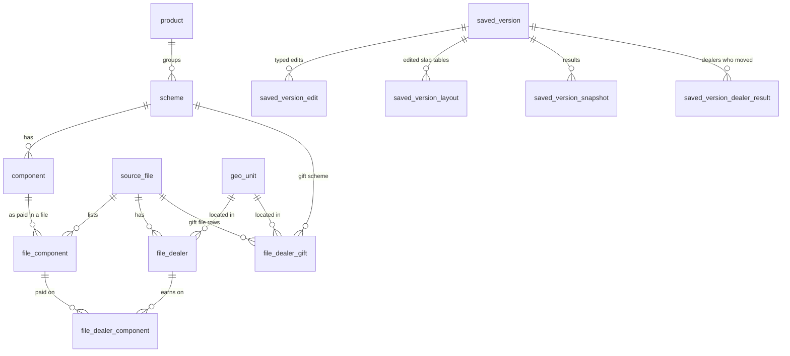

# The spi data store

The app's PostgreSQL store. All objects are in schema **`spi`**, so it can live in an existing database shared with other apps (dev: the shared `app_db`; local: the `spc-pg` container's `scheme_performance`; user's choice, 5 Nov 2026) or in a database of its own. Nothing outside the schema is created or changed. It stores:

- **each month's two newest files of each kind** (the newest and the one before it as a backup; user's choice, 5 Nov 2026), both the CN extract (`main`) and the gift file (`gift`). A load deletes the month's older files of its kind in the same transaction; GCS keeps every version. About 125 MB a main file;
- **saved Versions:** the user's what-if edits and their results.

The calculation engine stays in memory (pandas). The database is the system of record: at startup, or when a new file arrives, the API reads a month from it into memory. Edits are not stored until a Version is saved.

Derived views, such as slab tables and rates per region, are calculated by the engine, not stored. The database holds only:

- what the files say;
- the scheme definitions read from each file;
- the saved Versions.

## Layout

| Path | What it is |
|---|---|
| `backend/db/scheme_performance_calculator/migrations/` | Numbered SQL migrations. `0001_initial_schema.sql` creates the full schema. |
| `backend/app/spi/migrate.py` | Migration runner. It applies each file once and records it in `spi.schema_migration` with a checksum. |
| `backend/app/spi/load.py` | Loader: GCS file → database. |
| `backend/app/spi/frames.py` | Read path: database → the engine's in-memory frames. |
| `backend/app/spi/saved_versions.py` | Store for saved Versions. |
| `backend/app/spi/setup_local.py` | Local setup: creates the two logins and the database. |

## Setup

The commands run from `backend/`.

1. **Logins and database.** In an existing database, set `SPI_DATABASE_URL` and `SPI_OWNER_URL` to a login that may create a schema there (one login can be both: it then owns `spi`, and the migration grants nothing). For two logins in a new database, `python -m app.spi.setup_local` asks for a superuser login (typed in hidden, or `SPI_SUPERUSER_URL` in the shell; never read from or written to an env file) and uses it to create:
   - `spi_owner`, which owns the database and runs migrations and loads;
   - `spi_app`, the API's login, which only reads and writes data;
   - the database `scheme_performance_calculator`.

   It writes the generated passwords to `backend/.env.<APP_ENV>` as `SPI_OWNER_URL` and `SPI_DATABASE_URL`. On a server, a DBA creates the same two logins and the database, then sets those two URLs.
2. **Schema.** `python -m app.spi.migrate`. The Docker image also runs this at startup whenever `SPI_OWNER_URL` is set.
3. **Data.** Run one of these:
   - `python -m app.spi.load` loads the synced months;
   - `python -m app.spi.load --history` loads each month's two newest files of each kind from GCS (older ones are skipped before download).

   After that, the daily GCS sync loads each new file automatically.
4. **Use it.** Set `DATA_SOURCE=spi`. The default `files` reads the parsed files on disk. With `spi`, a month missing from the database is read from files.

### Loader options

`python -m app.spi.load [--year Y --month M] [--history] [--file NAME] [--force] [--prune]`

- **Skipping:** a file already loaded is skipped. "Already loaded" means the same name and GCS generation, under the current `LOADER_VERSION` and parser `CONFIG_VERSION`.
- **Automatic reload:** a file loaded under an older loader or parser version is reloaded.
- **`--force`:** reloads anyway.
- **`--prune`:** drops the files of months older than `LOADER_RETENTION_MONTHS` (0 keeps all). GCS keeps every file regardless.
- **One transaction per file:** the stored rows are checked against the parsed file. Any difference rolls the whole file back.

## Tables



There are 15 tables, 1 view and the runner's `schema_migration`.

### Reference data

These rows are added by the loader whenever a file shows a new one.

| Table | Key | Holds |
|---|---|---|
| `geo_unit` | `geo_id` | A zone, region and depot combination exactly as a file gives it. A region can move zone, and a depot can serve two regions. |
| `product` | `product_id` | Product group (`name`, `sort_order`). |
| `scheme` | `scheme_id` | `code` (e.g. `enamel_primer`) and `label`. `role` is one of `base`, `addon`, `whole_book`, `other` or `gift`. `pays_in` is `rupees` or `gifts`. |
| `component` | `component_id` | A scheme's component (unique on `scheme_id` + `name`). Formula and pack size are stored per file, in `file_component`, because they change between months. |

### Source files

| Table / view | Key | Holds |
|---|---|---|
| `source_file` | `file_id` | One row per GCS file version (unique on `file_name` + `gcs_generation`). See the column list below. |
| `live_file` (view) | `month`, `kind` | The newest file of each month and kind (latest `extract_date`, then `version`). This is the file the app shows. |

`source_file` columns:

- `month`, `kind` (`main` or `gift`), `version` (from `_v<n>` in the file name), `extract_date`, and `complete` (true when the month is settled);
- the counts `dealer_rows` and `component_rows`, and `file_payout` (the reconciliation total);
- `loader_version` and `parser_version`;
- `scheme_configs` (jsonb): the scheme definitions the parser read from the file header.

### Main file contents

Each of these tables is keyed by `file_id` and deleted with its file.

| Table | Key | Holds |
|---|---|---|
| `file_component` | `file_id`, `component_id` | How each component pays in this file: `scheme_label`, `formula` (`percent`, `per_pack`, `per_unit`, `fixed` or `qualifier`) and `pack_size`. |
| `file_dealer` | `file_id`, `dealer_code` | One row per dealer: `geo_id`, `customer_name`, `total_gsr` and `od_blocked`. |
| `file_dealer_component` | `file_id`, `dealer_code`, `component_id` | The engine's input: one row per dealer and component (see below). |

`file_dealer_component` details:

- **Columns:**
  - `row_no` keeps the file's order;
  - the dealer's measures: `volume`, `gsr`, `slab_basis` and `next_slab`;
  - what was paid: `cn_rate`, `cn_units` and `current_cn`;
  - the settlement figures: `scheme_cn`, `settled_cn` and `condonation_amount`;
  - the Clear Cut figures: `component_clear_cut` and `clear_cut_total`.
- **Partitions:** it is partitioned by `LIST (file_id)`. The loader creates one partition per file, named `file_dealer_component_f<file_id>`.

### Gift file contents

| Table | Key | Holds |
|---|---|---|
| `file_dealer_gift` | `file_id`, `dealer_code`, `scheme_id` | One row per dealer and gift scheme that has any figure. Columns: `volume`, `gsr`, `level` (the file's "CN%"), `clear_cut` (gifts earned), `next_slab`, `shortfall` and `row_no`. |

### Saved Versions

| Table | Key | Holds |
|---|---|---|
| `saved_version` | `version_id` | Name (unique, ignoring case and outer spaces), `note`, `base_month`, `volume_growth_pct` (V), `removed_schemes`, `status` (`DRAFT`, `SAVED` or `ARCHIVED`) and timestamps. |
| `saved_version_edit` | `version_id`, `period`, scope, `product`, `metric`, `mode` | The GSR and volume edits the user typed, for the current or next month. `scope_hash` is the md5 of `scope_value`. |
| `saved_version_layout` | `version_id`, `period`, `scheme_key`, `component` | Edited slab tables (jsonb). |
| `saved_version_snapshot` | `snapshot_id` | Results (see below). `schemes` (jsonb) holds the per-scheme figures and slab rows. |
| `saved_version_dealer_result` | `version_id`, `month`, `customer_code`, `scheme_key`, `component` | Dealers whose slab or rate moved: the actual figures alongside the Version's. |

`saved_version_snapshot` holds two kinds of result:

- **`live`:** one per month. It is rewritten when the Version or that month's file changes.
- **`save`:** one per save. It is never rewritten.

**Retention:** a Version saved in a month before the live month and the two before it is deleted, saved or archived, with its edits, results and snapshots (`VERSION_RETENTION_MONTHS=3`, the months kept with the live one; 0 keeps all). With November live, Versions of September, October and November are kept. It runs after each daily sync (`saved_versions.prune`), followed by `VACUUM (ANALYZE)` of these tables.

**Limit:** each login keeps at most 10 Versions that are not archived. A new save or a restore beyond that is refused (409); archiving or deleting one frees a place. A Version can also be deleted by hand (`DELETE /v1/saved-versions/{id}`).

### Load log

| Table | Holds |
|---|---|
| `load_run` | One row per load attempt: file, status (`running`, `loaded`, `skipped` or `failed`), row count and message. |

### Users and access (migration 0002)

| Table | Key | Holds |
|---|---|---|
| `app_user` | `user_id` | `username` (unique, ignoring case), `password_hash` (PBKDF2, never a password), `role`, `active`, `access_version` (bumped on any change, which ends that user's sessions), `last_login_at`. |
| `user_scheme` | `user_id`, `scheme_id` | The schemes a `SCHEME_MANAGER` may edit. A scheme's components follow from `component`. |
| `audit_log` | `event_id` | Logins, failed logins, user and access changes, Version saves, archives and deletes: `username`, `action`, `target`, `detail` (jsonb). |

`saved_version` also records `updated_by`, `created_by_id` and `updated_by_id`.

## Access

| | ADMIN | SCHEME_MANAGER | VIEWER |
|---|---|---|---|
| See every screen | ✓ | ✓ | ✓ |
| Dealer lists | ✓ | ✓ | ✗ |
| Edit a scheme (slab tables, its Volume / GSR / CN, a gift scheme's rule) | all | own schemes | ✗ |
| Product and total edits, V, removing schemes | ✓ | ✗ | ✗ |
| Save a Version | ✓ | ✓ (own schemes' edits only) | ✗ |
| Change, archive or delete a Version | any | own only | ✗ |
| Versions kept that are not archived | 10 | 10 | — |

The rules are enforced in three places:

- **UI:** a login sees edit boxes only where it may edit.
- **API (`app/access.py`):** every request carrying edits is checked, including calculations, and refused with 403. A request naming an opened Version (`X-Version-Id`) may carry that Version's own edits unchanged, so anyone can view anyone's Version.
- **Database:** row-level security on `saved_version`, `saved_version_edit` and `saved_version_layout`, forced on the table owner too. The API sets `spi.role`, `spi.username` and `spi.schemes` per transaction with `set_config(..., true)`. With none set (loader, recalculation, retention), every row is allowed.

The env file's built-in admin (`ADMIN_USERNAME` / `ADMIN_PASSWORD`) has no row here and stays as a way in. Users are managed from `backend/` (the owner's login):

```
python -m app.auth_user add <username> --role ADMIN|SCHEME_MANAGER|VIEWER [--schemes premium,primer]
python -m app.auth_user assign|revoke <username> <scheme>[,<scheme>...]
python -m app.auth_user role <username> <role>
python -m app.auth_user reset-password|deactivate|activate <username>
python -m app.auth_user list
```

## Conventions

- **Exact values:** dealer measures are `float8` and store the file's own Excel doubles exactly, so results from the database match results from the files.
- **Logins:** `spi_app` gets `SELECT`, `INSERT`, `UPDATE` and `DELETE` on every table, plus sequence usage, through default privileges. It cannot create or alter tables. It also cannot change `app_user` (except `last_login_at`) or `user_scheme`, and `audit_log` is append-only for it. Loads (which create partitions), migrations and user changes run as `spi_owner`.
- **Schema changes:** never edit an applied migration; the runner refuses a changed checksum. Add the next numbered file (`0002_<what>.sql`) instead.
- **Reloading after code changes:** after changing how a file is loaded or parsed, bump `LOADER_VERSION` (`app/spi/load.py`) or `CONFIG_VERSION` (`app/ingest/parse_raw.py`). The stored files are then reloaded on the next run.
