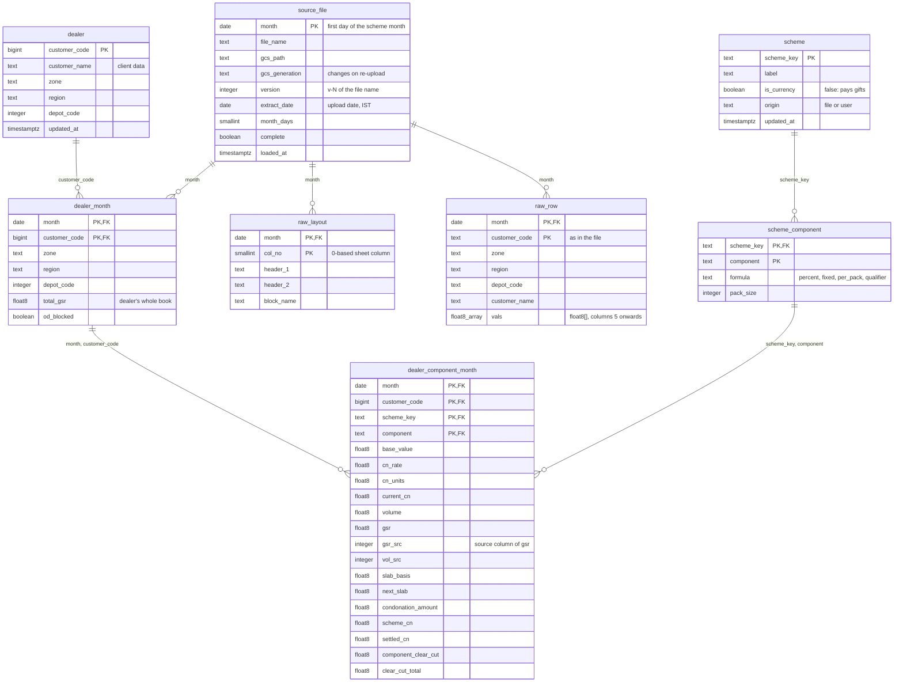
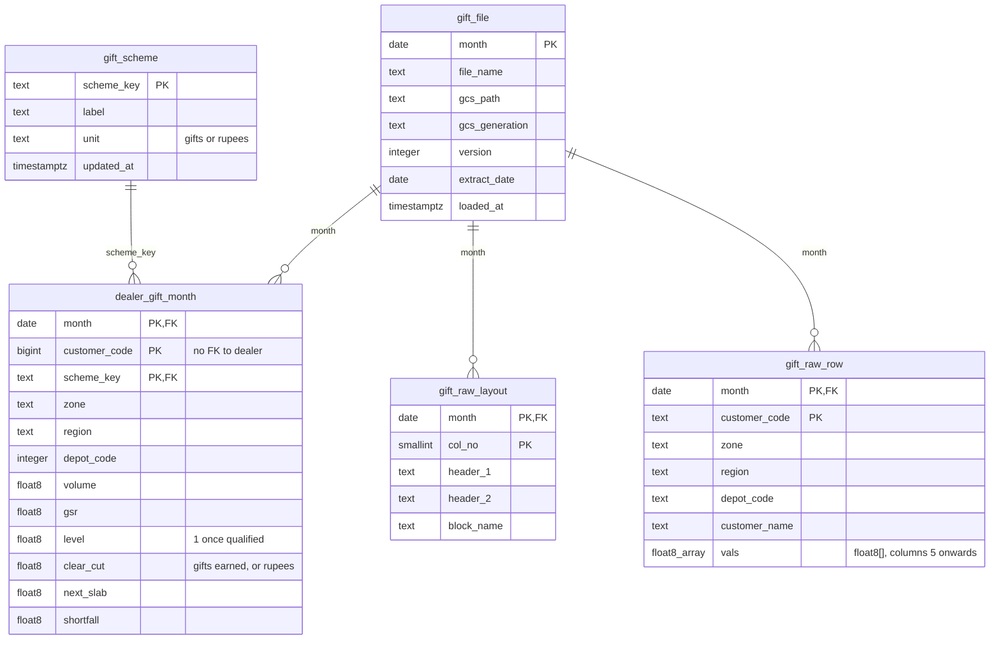
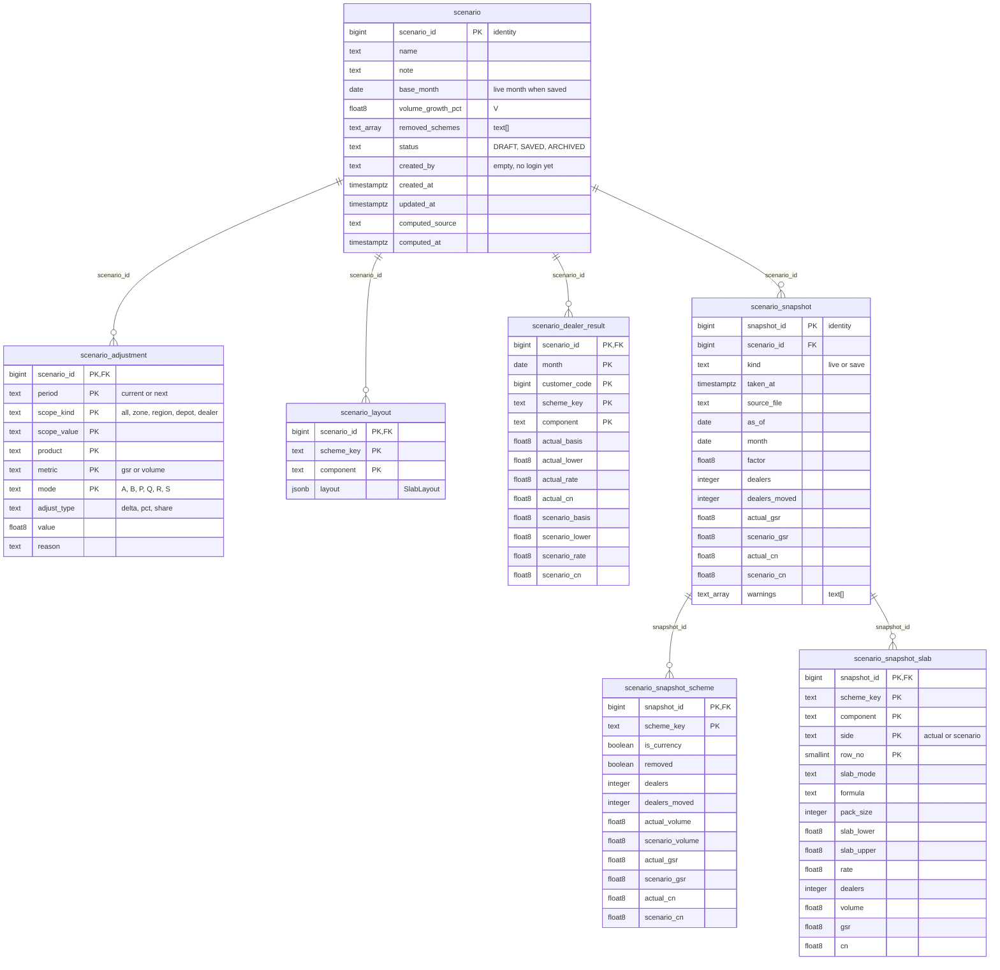

# Database ERD (Postgres, schema `spc`)

Source: [backend/app/db/schema.sql](../backend/app/db/schema.sql). Checked against the local database `spc-pg` on 2 Nov 2026: 20 tables, 2 views, 17 foreign keys, all as below. Update this file when `schema.sql` changes.

The tables fall in three groups that do not reference each other: the CN extract, the gift file and saved scenarios. Lines are real foreign keys only. References that exist in the data but have no foreign key are listed under [Links without a foreign key](#links-without-a-foreign-key).

All three on one image: [erd-combined.png](erd-combined.png). PNG copies of each diagram: [erd-1-cn-extract.png](erd-1-cn-extract.png), [erd-2-gift-file.png](erd-2-gift-file.png), [erd-3-scenarios.png](erd-3-scenarios.png). To regenerate them after a change: `npx -y @mermaid-js/mermaid-cli@11.4.2 -i docs/erd.md -o out.md -e png -w 2000 -s 2 -b white`, then rename `out-1.png` … `out-3.png`.

## 1. CN extract (one current version per month)

## 2. Gift / contest file (kept apart from CN)

## 3. Saved scenarios

## Delete rules

- `ON DELETE CASCADE`: every foreign key to `source_file`, `gift_file`, `scheme`, `scenario` and `scenario_snapshot`, and `dealer_component_month` → `dealer_month`. Deleting a month (retention) removes all its rows; deleting a scenario removes all its rows.
- No cascade (delete blocked while referenced): `dealer_month` → `dealer`, `dealer_component_month` → `scheme_component`, `dealer_gift_month` → `gift_scheme`.

## Links without a foreign key

| Column | Points to | Why no foreign key |
| --- | --- | --- |
| `dealer_gift_month.customer_code` | `dealer.customer_code` | A dealer can be in the gift file and not in the main one. |
| `raw_row.customer_code`, `gift_raw_row.customer_code` (text) | dealer code | Kept exactly as in the file. |
| `scenario.base_month`, `scenario_dealer_result.month`, `scenario_snapshot.month` | `source_file.month` | A scenario is kept after its month is pruned. |
| `scenario_layout`, `scenario_dealer_result`, `scenario_snapshot_scheme`, `scenario_snapshot_slab` (`scheme_key`, `component`) | `scheme_component` | Results stay valid as saved even if a scheme changes. |
| `scenario_dealer_result.customer_code` | `dealer.customer_code` | Same: kept after the dealer is pruned. |
| `scenario.removed_schemes` (`text[]`) | `scheme.scheme_key` | Array of keys. |

## Indexes besides primary keys

| Index | Columns |
| --- | --- |
| `dealer_month_scope` | `dealer_month (month, zone, region, depot_code)` |
| `dealer_component_month_scheme` | `dealer_component_month (month, scheme_key, component)` |
| `dealer_gift_month_scope` | `dealer_gift_month (month, zone, region, depot_code)` |
| `scenario_snapshot_live` (unique, `WHERE kind = 'live'`) | `scenario_snapshot (scenario_id, month)` |

## Views

| View | Shows |
| --- | --- |
| `raw_value` | `raw_row` × `raw_layout` as one row per dealer and column: `month, customer_code, col_no, block_name, metric, value` (`value = vals[col_no - 4]`). |
| `gift_raw_value` | The same for `gift_raw_row` × `gift_raw_layout`. |

Type note: Mermaid does not accept `[]` in a type, so `float8_array` and `text_array` stand for `float8[]` and `text[]`.
