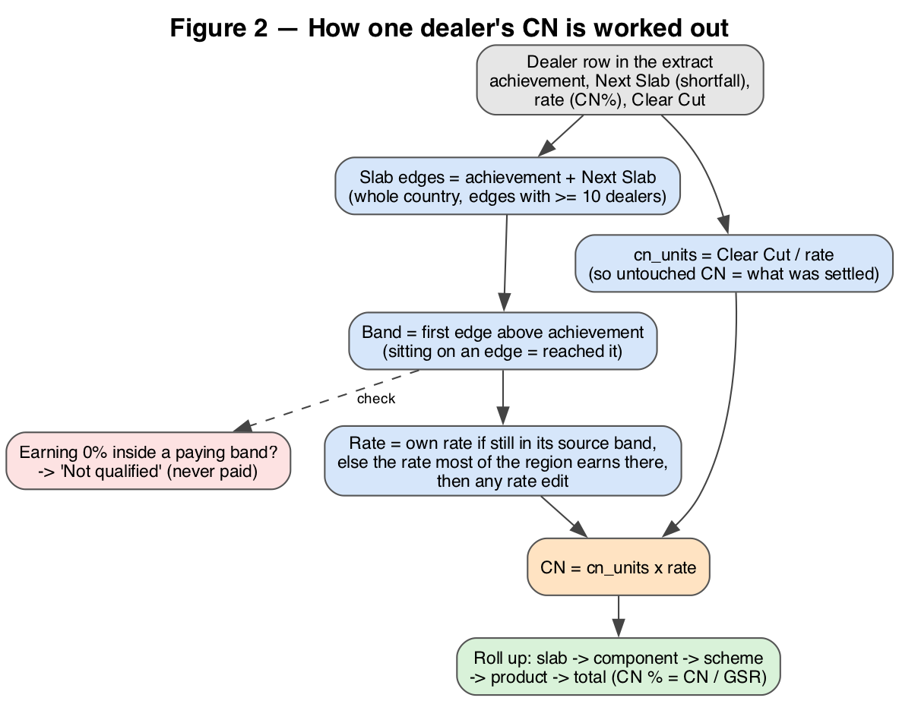

# Calculation Logic — with Examples

Every calculation the Scheme Performance & Impact Calculator makes, in plain words, with a worked example and the
place in the code where it lives. Use it to check a figure, to explain one to the client, or to change a rule.

- Dealers, regions, scheme names and amounts in the examples are **made up** (this is a sanitised public copy).
- "Code" points to the file and function. Line numbers are left out on purpose: they change.
- When a rule changes, update this document in the same change.



## Contents

1. [Terms and units](#1-terms-and-units)
2. [Choosing the file](#2-choosing-the-file)
3. [Reading the file into dealer rows](#3-reading-the-file-into-dealer-rows)
4. [Payout formulas](#4-payout-formulas)
5. [How the formula is chosen (calibration)](#5-how-the-formula-is-chosen-calibration)
6. [CN units: why an untouched row returns exactly what was paid](#6-cn-units-why-an-untouched-row-returns-exactly-what-was-paid)
7. [Fixed amounts (FA) and "Other (unattributed)"](#7-fixed-amounts-fa-and-other-unattributed)
8. [Early Bird](#8-early-bird)
9. [GSR and volume without double counting](#9-gsr-and-volume-without-double-counting)
10. [Slab edges from the data](#10-slab-edges-from-the-data)
11. [Putting a dealer in a slab](#11-putting-a-dealer-in-a-slab)
12. [Non-qualifiers ("Not qualified" row)](#12-non-qualifiers-not-qualified-row)
13. [Same-rate slabs merged in a filtered view](#13-same-rate-slabs-merged-in-a-filtered-view)
14. [Regional rate cards and moving a boundary](#14-regional-rate-cards-and-moving-a-boundary)
15. [Rate edits](#15-rate-edits)
16. [Adding and removing a slab, deleting a scheme](#16-adding-and-removing-a-slab-deleting-a-scheme)
17. [Products, mix and CN %](#17-products-mix-and-cn-)
18. [Previous, Current and Next month; Impact](#18-previous-current-and-next-month-impact)
19. [Next month: pace and V](#19-next-month-pace-and-v)
20. [Editing GSR, volume, mix, price and CN (modes B P A Q S R C)](#20-editing-gsr-volume-mix-price-and-cn-modes-b-p-a-q-s-r-c)
21. [Editing a slab row](#21-editing-a-slab-row)
22. [Cost of a sales target (Plan tab) and elasticity](#22-cost-of-a-sales-target-plan-tab-and-elasticity)
23. [Projecting a part month](#23-projecting-a-part-month)
24. [Trend, slab migration, dealers near the next slab](#24-trend-slab-migration-dealers-near-the-next-slab)
25. [Reconciliation](#25-reconciliation)
26. [Gift schemes](#26-gift-schemes)
27. [Dealer lists](#27-dealer-lists)
28. [Saved scenarios](#28-saved-scenarios)
29. [Loading the database](#29-loading-the-database)
30. [How figures are written on screen](#30-how-figures-are-written-on-screen)
31. [Where to change a rule](#31-where-to-change-a-rule)
32. [Assumptions still to confirm](#32-assumptions-still-to-confirm)

---

## 1. Terms and units

| Term | Meaning | Unit |
| --- | --- | --- |
| Dealer | One row of the extract (`Customer`). | — |
| Scheme | One block of columns in the extract (Premium, Primer, Early Bird ...). | — |
| Component | One payout line in a scheme (Primer: PAP, PBP, PDP ...). Most of the logic works per component. | — |
| Achievement (slab basis) | What decides the slab: `Volume Q X` (litres) or `GSR(Q) X` (rupees). | L or ₹ |
| Rate base | What the rate is paid on: `GSR(B) X` (rupees) or volume. | ₹ or L |
| Rate (`X CN%`) | The rate the dealer earned. Can be a %, ₹ per litre, ₹ per pack, or a flat ₹ amount. | varies |
| Next Slab / Short Fall | How far the dealer is from the next slab (not the slab edge itself). | L or ₹ |
| Clear Cut | The file's own payout for a component or scheme. Treated as the truth. | ₹ |
| cn_units | The number the rate is multiplied by: CN = cn_units × rate (§6). | varies |
| Scope | The filters in use: All India, or zones / regions / depots. | — |
| Business GSR | The dealer's whole book (§9). | ₹ |

A scope filter takes one or more values; an empty filter means "everything". The same filter rule is used by every
screen. Code: [scope.py](../backend/app/core/scope.py) `apply_scope`.

---

## 2. Choosing the file

**Rule.** For a month, list the files **directly** in `output/<YYYY>/<MM>/` (never `daily/`), keep only
`..._v<N>_no_condonation.xlsx`, then take the newest upload date (India time) and, on that date, the highest `v<N>`.
Do this separately for the two kinds of file:

- **main** — the header has a business GSR column (`GSR(B) Value`, `GSR(B) Value %` or `GSR(B) TMBR Value Slab`);
- **gift** — any other file in the folder.

A file's upload date is its extract date. A file extracted after its month ended counts as the complete month.

**Example.** October's folder holds (upload date, version, kind):

| File | Uploaded | Kind |
| --- | --- | --- |
| v20 | 28 Oct | main |
| v21 | 30 Oct | gift |
| v22 | 1 Nov | main |
| v23 | 1 Nov | gift |
| v24 | 1 Nov | gift |

Main = v22 (newest main). Gift = v24 (1 Nov, highest version). Picking only "the newest file" would have loaded v24,
a gift file, as October's CN — the reason for the two kinds.

Code: [gcs_sync.py](../backend/app/ingest/gcs_sync.py) `pick_latest`, `classify`, `pick_latest_by_kind`.

---

## 3. Reading the file into dealer rows

**Rule.** The sheet `Output` has a 2-row header: row 1 is the scheme block, row 2 the metric. The engine finds every
scheme block and its components from the header, then writes **one row per dealer × component** where the dealer
has something in that component. Each row carries: zone, region, depot, dealer, scheme, component, formula,
achievement, next slab, rate, cn_units, CN, volume, GSR, and the source column of the volume and GSR (§9).

The layout is detected from the header, not the file name. Three layouts are supported so far (September "grouped",
August "working", July "uniform").

**Example.** One dealer with sales in Premium 01 and Premium 02 and in Primer PAP gives three rows:
`(dealer, premium, PREMIUM 01)`, `(dealer, premium, PREMIUM 02)`, `(dealer, primer, PAP)`.
A month's file: tens of thousands of dealer rows → about half a million dealer × component rows.

Code: [discover_schemes.py](../backend/app/ingest/discover_schemes.py) `discover`,
[parse_raw.py](../backend/app/ingest/parse_raw.py) `parse_raw_file`,
[load_month.py](../backend/app/ingest/load_month.py).
The parsed result is cached as parquet next to the file; the cache name carries `CONFIG_VERSION` (bump it when a
parsing rule changes) and the scheme count.

---

## 4. Payout formulas

Every component pays by one of five formulas. All are written as **CN = cn_units × rate**, so a rate edit is the
same multiplication for every type.

| Formula | CN | cn_units | Example components |
| --- | --- | --- | --- |
| `percent` | rate base × rate ÷ 100 | rate base ÷ 100 | Luxury, Premium, Waterproofing, Value %, Early Bird |
| `per_unit` | volume × rate | volume | Stainers Per L |
| `per_pack` | floor((volume − floor) ÷ pack) × rate | whole packs | Per 50 L / Per 100 L add-ons, Damp Guard Per 40 |
| `fixed` | rate (the "rate" is rupees) | 1 | STAINERS, DAMP GUARD, VALUE FA, Primer FA |
| `qualifier` | 0 (sets a rate, pays nothing itself) | 0 | Blocks whose own Clear Cut is zero everywhere |

**Examples.**

- *percent*: Luxury, GSR(B) ₹1,55,500.44, rate 1 → CN = 1,55,500.44 × 1 ÷ 100 = **₹1,555.00**.
- *per_unit*: Stainers Per L, 120 L at ₹2 per litre → CN = 120 × 2 = **₹240**.
- *per_pack*: Lux Interior Per 50 L, 230 L at ₹100 per pack → floor(230 ÷ 50) = 4 packs → **₹400**. A part pack
  earns nothing.
- *per_pack with a floor*: Damp Guard Per 40, flat up to 80 L, then ₹500 per 40 L: 250 L → floor((250 − 80) ÷ 40) =
  floor(4.25) = 4 → **₹2,000**.
- *fixed*: VALUE FA "CN%" = 800 → CN = **₹800** (a flat amount, though the column says CN%).

Packs hidden in names (confirmed on the data): TERRA 15 pays per 25 L; "Waterproofing Per L" pays per 50 L.

Code: [parse_raw.py](../backend/app/ingest/parse_raw.py) (cn_units per formula),
[scheme_config.py](../backend/app/core/scheme_config.py) `Component`.

---

## 5. How the formula is chosen (calibration)

**Rule.** Column names do not say the formula (`VALUE FA CN%` is rupees, not a %). For every component that has its
own Clear Cut column, the engine tries every candidate — `fixed`; and for each possible base column `percent`,
`per_unit`, and `per_pack` with packs 1, 4, 5, 10, 12, 20, 24, 25, 40, 50, 100, 200, 250, 500, 1000 (and a solved
floor for per-pack) — on the dealers who were paid, and keeps the candidate that matches the Clear Cut most often.

- A match = within 1% (or ₹0.50).
- The winner must explain at least **95%** of paid rows; otherwise the component is flagged unresolved.
- A block whose own Clear Cut is zero for everyone but has rates is a `qualifier`.
- Components with no Clear Cut of their own (Early Bird windows) are fixed by the scheme total: the engine tries
  `percent` and `per_unit` for them together and keeps the one whose sum matches the scheme's Clear Cut. (One month
  writes 0.4 for 0.4%, another 0.005 for the same rate; guessing wrong is a 100× error.)

**Example.** "Waterproofing Per L", 500 paid dealers. `per_unit` matches 3% of them, `per_pack` with pack 50
matches 99.6% → formula `per_pack`, pack 50.

**Example (floor).** Damp Guard Per 40: for each paid dealer, packs n = Clear Cut ÷ rate, and volume − n × 40 lands
between the floor and floor + 40. The median of that remainder, rounded down to a whole pack, gives the floor (80 L).

Code: [calibrate.py](../backend/app/ingest/calibrate.py) `calibrate_component`, `_solve_offset`,
`calibrate_scheme`. Settings: `MATCH_TOL = 0.01`, `MIN_MATCH_SHARE = 0.95`, `COMMON_PACKS`.

---

## 6. CN units: why an untouched row returns exactly what was paid

**Rule.** Where the component has its own Clear Cut, cn_units is **re-derived from the settled payout**:

```
cn_units = Clear Cut ÷ rate          (when rate ≠ 0)
cn_units = 0                         (when rate = 0; a dealer who earned nothing has no units)
CN now   = Clear Cut                 (exactly)
```

So for an untouched row, cn_units × rate = Clear Cut to the rupee, whatever rounding the file used. A dealer who
earned nothing has 0 units, so raising a rate can never start paying someone who never qualified.

**Never** take a settled CN and scale it by a percentage to get a new CN; always cn_units × the new rate.

**Example.** Clear Cut ₹1,555.00 at rate 1 → cn_units = 1,555. Raise the rate to 1.25 → CN = 1,555 × 1.25 =
**₹1,943.75**. Set it back to 1 → **₹1,555.00** again, exactly.

Code: [parse_raw.py](../backend/app/ingest/parse_raw.py) (block starting "Where the file publishes this component's
OWN Clear Cut").

---

## 7. Fixed amounts (FA) and "Other (unattributed)"

**Rule.** Some lines have a rate but no Clear Cut of their own (`VALUE FA`, `Primer FA`, `VELVET TOUCH FA`,
`Terra FA`). Their amount is added straight into the scheme's Clear Cut. For each dealer and scheme:

```
residual = scheme Clear Cut − (each component Clear Cut column, counted once) − (lines with no Clear Cut of their own)
```

If the residual is not zero (more than ₹0.005), it becomes an extra row **"Other (unattributed)"**: real money, shown
under the scheme, with cn_units 0 (no rate can scale it). In Next month and in growth it is **carried at its actual
amount** (times any CN % edit of its product, §20 mode R).

**Example.** A dealer's Primer Clear Cut is ₹5,300. Its components' Clear Cuts are PAP ₹3,000 + PBP ₹2,000 = ₹5,000.
`Primer FA` = ₹300 has no Clear Cut of its own. Residual = 5,300 − 5,000 − 300 = **₹0** → no extra row. If the scheme
Clear Cut were ₹5,450, an "Other (unattributed)" row of **₹150** is added.

Code: [parse_raw.py](../backend/app/ingest/parse_raw.py) (residual block),
[plan.py](../backend/app/core/plan.py) `_carried`, `_carried_cn`.

---

## 8. Early Bird

Early Bird has three time windows (EB 1, EB 2, EB 3) and a full-month section. Two payout regimes, by zone:

| Zone | Payout | Example |
| --- | --- | --- |
| North, East, West, Central | `GSR(B) EB FULL MONTH × EB FULL MONTH CN% ÷ 100` | Full-month GSR ₹10,00,000 at 0.5% → **₹5,000** |
| South (no full-month column) | Sum over the windows of `GSR(B) EB i × EB i CN% ÷ 100` | EB1 ₹3 L × 0.3% + EB2 ₹4 L × 0.2% + EB3 ₹2 L × 0.1% = 900 + 800 + 200 = **₹1,900** |

The engine builds per-window components only for dealers with no full-month GSR, so the two regimes never both pay
the same dealer. Each window's slab is decided on that window's own GSR(Q).

A dealer who fails to hold the slab reached in an earlier window earns 0% in the later one, whatever they sell —
see §12.

Code: [scheme_config.py](../backend/app/core/scheme_config.py) (Early Bird override, `requires_zero`).

---

## 9. GSR and volume without double counting

### 9.1 Business GSR (the dealer's whole book)

```
Business GSR = GSR(B) Value + GSR(B) Value % + GSR(B) TMBR Value Slab        (once per dealer)
```

A dealer has a figure in either Value or Value %, not both. **Do not** use the Early Bird full-month GSR: South has
no such scheme, so it is empty for every South dealer (a large share of the book would go missing).

**Example.** Value ₹4,00,000, Value % empty, TMBR ₹50,000 → business GSR **₹4,50,000**. A scope's GSR is the sum of
this over its dealers (each dealer once).


### 9.2 A scheme's GSR and volume

Within a scheme, **each source column counts once per dealer**: components that read the same column collapse,
components that read different columns add up. Scheme GSRs are **never** added across schemes (the same sale sits in
several schemes); the total is always the business GSR.

**Example.** Early Bird's EB 1, EB 2, EB 3 all read `GSR(B) EB FULL MONTH` → that column counts once (₹100 Cr, not
3 × ₹100 Cr). Premium 01 and Premium 02 read different columns (different products) → they add.

Code: [discover_schemes.py](../backend/app/ingest/discover_schemes.py) `TOTAL_GSR_METRICS`,
[categories.py](../backend/app/core/categories.py) `_dedup_sum`.

---

## 10. Slab edges from the data

**Rule.** The extract has no slab table. But a dealer's achievement plus their shortfall lands exactly on the next
slab edge, so:

```
candidate edge = round(achievement + Next Slab, 2)        for every dealer with Next Slab > 0
```

A candidate is kept as a real edge when at least **max(10, 0.1% of the component's dealers)** dealers point at it.
The edges are kept only if there are **20 or fewer** and they explain at least **50%** of the dealers with a next
slab. Otherwise the component has **per-dealer targets** (for example last year's volume × growth): there is no
common table, and the rows are grouped by rate instead ("target" mode).

Edges are always taken from the **whole country**, never from the filtered view. A slab table belongs to the scheme;
Delhi may have only one dealer above 4,000 L, but 4,000 is still an edge.

**Example.** Premium, 12,000 dealers (threshold = max(10, 12) = 12):

| Dealer | Achievement (L) | Next Slab (L) | Sum |
| --- | --- | --- | --- |
| A | 30 | 10 | 40 |
| B | 100 | 50 | 150 |
| C | 120 | 30 | 150 |
| D | 280 | 20 | 300 |
| E | 900 | 0 | (top slab, no next slab) |

If 40, 150, 300 and 650 each have 12 or more dealers pointing at them, the edges are **40 / 150 / 300 / 650**, and
the bands are 0–40, 40–150, 150–300, 300–650, 650+.

The slab is measured in the slab basis column, which can differ from the rate base: Luxury's slab is in **litres**,
its rate is a % of **rupees**. Mixing the two gives nonsense edges.

Code: [slab_engine.py](../backend/app/core/slab_engine.py) `_slab_edges`, `_edges_for`. Settings:
`MIN_DEALERS_PER_EDGE = 10`, `MIN_SHARE_PER_EDGE = 0.001`, `MAX_EDGES = 20`, `MIN_COVERAGE = 0.5`.
Another month's slab table is built from that month's own edges (`build_slabs(..., edge_frame=)`).

---

## 11. Putting a dealer in a slab

**Rule.** The dealer's band is the number of edges at or below their achievement. A dealer **exactly on** an edge
has reached that slab.

**Example.** Edges 40 / 150 / 300 / 650.

| Achievement | Band | Slab |
| --- | --- | --- |
| 25 L | 0 | 0–40 |
| 40 L | 1 | 40–150 (on the edge = reached) |
| 149.9 L | 1 | 40–150 |
| 150 L | 2 | 150–300 |
| −12 L (returns > purchases) | 0 | first slab |

Each slab row then shows: dealers, achievement, volume, GSR, cn_units, CN, CN % (CN ÷ GSR), and the regions in it.

Code: [slab_engine.py](../backend/app/core/slab_engine.py) `build_slabs` (`searchsorted(..., side="right")`).

---

## 12. Non-qualifiers ("Not qualified" row)

**Rule.** A dealer earning **0% inside a paying band** did not qualify (Early Bird: they did not hold the slab they
reached in the previous window). They are taken out of the band into one **"Not qualified"** row per component, and
they are **never paid**, even if the band's rate is raised or they grow into a higher band.

This applies only when 0% dealers appear in **more than one** band; then it covers 0% dealers at or above the first
paying band. Dealers in a leading 0% band (below the first paying slab, for example Premium 0–40 L) are a real slab,
not non-qualifiers.

Qualification is always judged on the **actual** month. In a grown or edited month, a dealer who was simply below
the first slab and grows past it does start earning; a non-qualifier does not.

**Example.** EB 2 bands: 0–₹5 L pays 0%, ₹5 L–₹10 L pays 0.3%, ₹10 L+ pays 0.5%.

| Dealer | EB 2 GSR | Rate earned | Shown as |
| --- | --- | --- | --- |
| A | ₹3 L | 0% | slab 0–₹5 L (leading 0% slab) |
| B | ₹7 L | 0.3% | slab ₹5 L–₹10 L |
| C | ₹7 L | 0% | **Not qualified** |

Raise ₹5 L–₹10 L to 0.4%: B earns more; C still earns ₹0.

Code: [slab_engine.py](../backend/app/core/slab_engine.py) `_non_qualifiers`, `_collapse_unqualified`.

---

## 13. Same-rate slabs merged in a filtered view

**Rule.** After bucketing, neighbouring bands that pay the **same rate to the same regions** in the current scope are
shown as one row. Regions run different rate cards, so the national edges can split one regional slab in two.

**Example.** National edges 40 / 125 / 150 / 300 / 650 (125 comes from another region's card). Delhi pays 5.75% in
both 40–125 and 125–150. Viewed for Delhi, they show as **one row: 40–150 @ 5.75%**. Viewed for All India, a band
shows one row per rate paid in it.

Code: [slab_engine.py](../backend/app/core/slab_engine.py) `_merge_same_rate_bands`.

---

## 14. Regional rate cards and moving a boundary

**Rule.** When slab boundaries are edited, each new band names the **original band it comes from** (its source
band). Then, dealer by dealer:

1. A dealer whose achievement is **still inside the source band** keeps **exactly their own rate**.
2. A dealer who **crossed into** the band gets the rate **most dealers of their region** earn in the source band
   (the most common rate; the national most common rate if the region has nobody there).
3. A non-qualifier stays at 0 (§12).
4. The first band is open below 0, so negative achievement stays in it.

So an unchanged table moves ₹0 (checked on every component in three scopes), and boundaries can be moved at All
India even though regions run different cards.

**Example.** Premium served bands 40–150 and 150–300. North pays 5.0% / 6.0%; West pays 4.5% / 5.5%. The user moves
the edge **150 → 120**. New bands: 40–120 (source 40–150) and 120–300 (source 150–300).

| Dealer | Region | Achievement | Before | After | Why |
| --- | --- | --- | --- | --- | --- |
| A | North | 100 L | 5.0% | 5.0% | still inside its source 40–150 |
| B | North | 130 L | 5.0% | **6.0%** | crossed into 120–300; North's most common rate in 150–300 |
| C | West | 130 L | 4.5% | **5.5%** | same, West's card |
| D | North | 200 L | 6.0% | 6.0% | still inside 150–300 |

The browser always sends this "sources" form, built from every distinct boundary of the served rows (not one row
per band). A per-dealer-target component starts as one band 0–∞ and gets boundaries with "+".

**Slab edits stay when the filters change** (user's choice, 3 Nov 2026), as a saved scenario carries them.

Code: [slab_engine.py](../backend/app/core/slab_engine.py) `assign_dealers`,
[plan.py](../backend/app/core/plan.py) `default_layout`, [App.tsx](../frontend/src/App.tsx) `layoutOf`.

---

## 15. Rate edits

**Rule.** A rate edit is stored as **(band, old rate, new rate)**: in that band, dealers whose rate is the old rate
are paid the new rate. Dealers on another region's card in the same band are not touched. Then
CN = cn_units × new rate.

In the browser, for a slab row that has not been re-slabbed:

```
new CN = actual CN                          if the rate is unchanged
new CN = actual CN × new rate ÷ old rate    if the old rate ≠ 0
new CN = cn_units × new rate                if the old rate = 0, or the row was re-slabbed
```

(For an untouched row, actual CN = cn_units × old rate, so these agree.)

**Example.** Band 150–300 has North dealers at 6.0% (CN ₹12,00,000) and West dealers at 5.5%. The user types 6.5%
on the North row → North CN = 12,00,000 × 6.5 ÷ 6.0 = **₹13,00,000**. West unchanged.

A rate edit made in one region and kept when the filter changes applies, in any scope, to the dealers in that band
who earned that old rate; a message says so.

Code: [slab_engine.py](../backend/app/core/slab_engine.py) `assign_dealers` (`rate_overrides`),
[computeImpact.ts](../frontend/src/api/computeImpact.ts) `withSimulatedRate`.

---

## 16. Adding and removing a slab, deleting a scheme

| Action | Rule | Example (edges 40 / 150 / 300) |
| --- | --- | --- |
| **+ (add)** | Split the band at its middle (rounded). Both halves keep the same source and the same rate edits, so nothing changes until a rate or boundary is edited. | + on 150–300 → new edge 225: bands 150–225 and 225–300, both pricing as 150–300. |
| **× (remove)** | The slab's lower edge goes; its dealers drop into the slab below, and the merged band prices like the lower one. | × on 150–300 → edges 40 / 300: band 40–300 pays each dealer their region's 40–150 rate. |
| **× on the first slab** | There is no slab below, so it pays 0. | × on 0–40 → dealers below 40 L earn ₹0. |
| **Delete scheme** | The scheme pays nothing in Current and Next. Its volume and GSR stay (the sales still happen). Restore, Reset or Reset all bring it back with its edits. | Deleting Stainers: CN falls by Stainers' CN; GSR unchanged. |

Code: [App.tsx](../frontend/src/App.tsx) `addSlab`, `removeSlab`, `simRows`;
`removed_schemes` in `POST /months/next` ([routers/months.py](../backend/app/routers/months.py)).

---

## 17. Products, mix and CN %

The extract has no product column, so a **product is a set of schemes** (inferred from scheme names; to be confirmed
by the client):

| Kind | Gives the product | Examples |
| --- | --- | --- |
| **Base** scheme | volume, GSR and CN | luxury → Luxury; premium → Premium; hue_basic_glow_max → Economy; primer → Primer; roller → Tools |
| **Add-on** scheme | CN only (its sales are the base scheme's again) | lux_… → Luxury; zen_…, aquawash → Premium; cs_…, pb_… → Economy |
| **Whole book** | one line "Value & Early Bird (whole book)", CN only | value_slab, tmbr_value_slab, early_bird, tmbr_early_bird |
| Anything else | "Other products" | — |

Formulas in the month table:

```
Product volume  = sum of its base schemes' volume       (each source column once)
Product GSR     = sum of its base schemes' GSR
Mix             = product volume ÷ total product volume × 100
Product CN      = base + add-on schemes' CN
CN %            = product CN ÷ product GSR × 100
Whole-book CN % = whole-book CN ÷ business GSR × 100
Other products  = business GSR − sum of product GSR      (GSR only)
Total CN %      = total CN ÷ business GSR × 100
```

**Example.** Business GSR ₹100 Cr; products: Luxury ₹20 Cr (2,000 kL), Premium ₹50 Cr (6,000 kL), Economy ₹28 Cr
(4,000 kL). Luxury CN ₹1.6 Cr.

- Total product volume = 12,000 kL → Luxury mix = 2,000 ÷ 12,000 = **16.7%**.
- Luxury CN % = 1.6 ÷ 20 = **8.0%**.
- Other products = 100 − (20 + 50 + 28) = **₹2 Cr**. A negative figure means two schemes count the same sales
  (this does happen in real months).

An add-on's volume and GSR are shown (muted) on its own row, never added to the product.

Code: [categories.py](../backend/app/core/categories.py) `BASE`, `ADDON_PREFIXES`, `WHOLE_BOOK_SCHEMES`,
`category_of`, `category_table`.

---

## 18. Previous, Current and Next month; Impact

| Column | What it is | Slab edges | Impact |
| --- | --- | --- | --- |
| **Previous** | The latest month before the live one with a file, as settled. Read-only. | That month's own | — |
| **Current** | The live month, with this user's edits. | Live month, national | simulated CN − actual CN |
| **Next** | The (edited) current month × pace × (1 + V), then next month's own edits, under the slab tables being planned. | Next month's own tables, else the current month's | planned CN − CN of next month **with no edits** (same pace and V, served tables) |

**Example.** Current month actual CN ₹20.00 Cr. The user's edits give ₹21.20 Cr → Current impact **+₹1.20 Cr**.
Next month with no edits (pace and V only) = ₹23.00 Cr; with the edits and the planned tables = ₹24.10 Cr → Next
impact **+₹1.10 Cr**.

A higher CN is coloured as a cost (red); a lower one is slate blue (never green, never "saving").

Code: [routers/months.py](../backend/app/routers/months.py) `POST /months`, `POST /months/next`;
[MonthsView.tsx](../frontend/src/components/MonthsView.tsx).

---

## 19. Next month: pace and V

**Rule.**

```
pace   = days in month ÷ days elapsed        (1 when the current month is complete)
factor = pace × (1 + V ÷ 100)
```

Every dealer row is grown by the factor, each formula as it behaves:

| Formula | Grown cn_units |
| --- | --- |
| percent, per_unit | cn_units × factor |
| per_pack | published packs + (whole packs at grown volume − whole packs at actual volume) |
| fixed, qualifier | unchanged (a flat amount does not grow with sales) |

Achievement, volume, GSR and business GSR are multiplied by the factor. Then each component is re-slabbed (§14), so
a dealer who grows across a boundary is paid that band's rate. Qualification stays on the actual month (§12).
Payout no slab explains is carried at its actual amount (§7).

**Example (factor).** Live file is day 28 of 31, V = 5% → pace = 31 ÷ 28 = 1.1071; factor = 1.1071 × 1.05 =
**1.1625**.

**Example (per pack).** Per 50 L at ₹100, published 4 packs for 230 L. Factor 1.1625 → 267.4 L → floor(267.4 ÷ 50) =
5; floor(230 ÷ 50) = 4 → packs = 4 + 5 − 4 = **5** → ₹500.

**Example (crossing).** A North dealer at 140 L in Premium (40–150 at 5.0%) grows to 140 × 1.1625 = 162.75 L → band
150–300 → paid North's rate there, **6.0%**.

Code: [plan.py](../backend/app/core/plan.py) `growth_factor`, `plan_schemes`;
[slab_engine.py](../backend/app/core/slab_engine.py) `grow_frame`.

---

## 20. Editing GSR, volume, mix, price and CN (modes B P A Q S R C)

The user clicks a figure in the Current or Next column and types a new one. **The cell decides what the edit means**
(user's choice, 2 Nov 2026).

### 20.1 From a typed figure to a stored edit

Every edit except a mix target is stored as a **% change**, solved from what the cell showed, so typing over an
edited cell **replaces** its edit instead of stacking on it:

```
value % = ( typed ÷ shown × (1 + old % ÷ 100) − 1 ) × 100
```

**Example.** A product's GSR was ₹100 Cr; an earlier edit of +10% shows ₹110 Cr. The user types ₹121 Cr →
121 ÷ 110 × 1.10 − 1 = 0.21 → the edit becomes **+21%** (not +10% then +10%). Typing ₹100 Cr back gives 0% and the
edit is dropped.

### 20.2 The modes

| Mode | Cell typed | What moves | What stays |
| --- | --- | --- | --- |
| **B** | Total Volume or GSR | Every product of each dealer by the same %, and the whole book | — |
| **P** | A product's Volume or GSR | That product only; the dealer's total moves with it | Other products |
| **A** | A product's Mix ("total held") | Sales move into the product; the dealer's other products give up the same rupees **in proportion** | Each dealer's total GSR |
| **Q** | A product's GSR as a price | GSR per litre: GSR, %-of-GSR CN, rupee slabs | Litres, litre slabs, per-litre and per-pack CN |
| **S** | A scheme's Volume or GSR | That scheme's rows only (a base scheme's sales also move the dealer's total) | Other schemes |
| **R** | A product's CN % or CN; the total's CN (product `*`) | Every rate of the product's schemes (or of all schemes) scales, carried payout included | Volume, GSR |
| **C** | A scheme's CN or CN % | Every rate of that scheme scales | Volume, GSR |

Rules common to all modes:

- **Litres follow each dealer's own ₹ per litre** of the product.
- A dealer with **no sales** in a product is not moved by that product's edit (there is no rate card to price new
  sales). For one dealer this is reported as a warning.
- Rows of schemes outside any product (Value, Early Bird, add-ons with no base) follow the dealer's **total**.
- After the factors are set, the month is grown (§19, `grow_frame`) and re-slabbed (§14). Dealers who cross a
  boundary change slab; qualification stays on the actual month.

### 20.3 Scope and order

An edit's scope is the filters it was typed through (All India, or zones / regions / depots, "A|B" for several, or a
list of dealers). **Every view applies every edit**: a region's edit shows in All India, and an All India edit shows
inside the region. Order: broader scopes first (All India → zone → region → depot → dealer); within a scope
B, P, Q, A, S, R, C.

### 20.4 Examples

**B (total +5%).** A dealer with Luxury ₹1 L, Premium ₹3 L, Economy ₹1 L → ₹1.05 L, ₹3.15 L, ₹1.05 L; total ₹5.25 L.

**P (Luxury +20%).** Same dealer → Luxury ₹1.2 L; others unchanged; total ₹5.2 L. Luxury litres × 1.2.

**A (Luxury +20%, total held).** Luxury gains ₹20,000. The other sales (₹4 L) give it up in proportion: Premium
−₹15,000, Economy −₹5,000 → ₹1.2 L / ₹2.85 L / ₹0.95 L; total still ₹5 L. Litres: Luxury × 1.2, Premium and
Economy × 0.95.

**A with a target mix.** Typing a mix (for example 25%) solves, by search, the same % move for every dealer in scope
that gives the product 25% of the scope's product volume. If it cannot be reached with the total held, the edit is
refused.

**Mix "volume grows"** (the other choice of the Mix toggle). Only this product sells more; the others stay. The
product's new volume v′ for a target share t, with product volume v and total volume T:

```
v′ = t × (T − v) ÷ (1 − t)
```

Luxury 200 kL of 1,000 kL (20%), target 25% → v′ = 0.25 × 800 ÷ 0.75 = **266.7 kL** (check: 266.7 ÷ 1,066.7 = 25%).
This is stored as a P Volume edit and replaces any "total held" Mix edit of the product.

**Q (Luxury price +4%).** GSR ₹1 L → ₹1.04 L; litres unchanged. Luxury's slab is in litres, so no dealer changes
slab; its %-of-GSR CN rises 4%. A rupee-slabbed scheme on the same sales would also see its slab achievement rise 4%.

**R (Luxury CN % from 8.0% to 7.0%).** All Luxury rates × 7 ÷ 8 = × 0.875 (−12.5%), including the carried
"Other (unattributed)" payout.

**C (Stainers CN from ₹40 L to ₹44 L).** Every Stainers rate × 1.10.

**S (Premium scheme volume −10%).** Only Premium's rows shrink 10% (litres, GSR, achievement); dealers may drop a
slab; the dealer's total falls by Premium's rupees × 10%.

Code: [scenario.py](../backend/app/core/scenario.py) `dealer_factors`, `_move_into`, `_solve_share`,
`_apply_price`, `scenario_frame`; [App.tsx](../frontend/src/App.tsx) `modeOf`, `editCell`.

---

## 21. Editing a slab row

Slab rows are editable in the Current and Next columns (3 Nov 2026).

| Cell | Becomes | Formula |
| --- | --- | --- |
| **CN** | A rate edit on the row | new rate = rate × typed CN ÷ shown CN |
| **CN %** | The same rate edit | typed % → CN = % × slab GSR, then as CN |
| **Volume / GSR** | Mode S on the **slab's dealers** (codes fixed when first typed) | % from §20.1; dealers may cross slabs |
| **Mix, total held** | Two mode-S edits: the slab's dealers × a, the component's other dealers × b | a = t × T ÷ v, b = (1 − t) × T ÷ (T − v) |
| **Mix, volume grows** | A Volume edit on the slab | v′ = t × (T − v) ÷ (1 − t) |

(v = slab volume, T = component volume, t = typed share.)

**Example (CN).** Slab pays 6.0% and shows CN ₹12 L; the user types ₹13.2 L → new rate = 6.0 × 13.2 ÷ 12 = **6.6%**.

**Example (Mix, total held).** Slab 200 kL of a component's 1,000 kL (20%); type 25% → a = 0.25 × 1,000 ÷ 200 = 1.25
(slab dealers +25%), b = 0.75 × 1,000 ÷ 800 = 0.9375 (others −6.25%). Result 250 + 750 = 1,000 kL.

Next month's slab tables are separate: the first Next edit copies the current month's table, and "Use current
month's" drops it.

Actual CN is never editable: it is the baseline Impact is measured against.

Code: [App.tsx](../frontend/src/App.tsx) `editSlab`, `editSlabSales`, `editSlabMix`, `nextEditOf`.

---

## 22. Cost of a sales target (Plan tab) and elasticity

**Rule.** "What does X% more sales cost in CN?" is **not** CN × X%. Each dealer's achievement is grown by g and
re-slabbed against the same table. A dealer who crosses into a new band keeps their own rate scaled by the step
between the bands:

```
new rate = own rate × (median rate of the new band ÷ median rate of the old band)
```

(If the old band paid nothing, the new band's median rate; non-qualifiers stay at 0.) Units grow as in §19
(packs: only whole packs completed). Unexplained payout is carried unchanged.

```
elasticity = (grown CN ÷ base CN − 1) ÷ g
```

Above 1 means the slabs amplify the target. A scheme can be given its own g; edited rates can be folded in as a
multiplier (simulated CN ÷ current CN, an approximation when only some bands changed).

**Example.** Base CN ₹10.0 Cr; with 5% more sales, 400 dealers cross a slab and CN is ₹11.0 Cr → elasticity =
(1.10 − 1) ÷ 0.05 = **2.0**: each 1% of sales costs about 2% more CN.

Note: this crossing rule (median step) differs from the Next month rule (§14, region's most common rate). Align them
if the client wants one figure in both places.

Code: [growth.py](../backend/app/core/growth.py) `grow_component`, `grow_portfolio`; `POST /growth`.

---

## 23. Projecting a part month

**Rule.** Sales accrue roughly evenly; payout does not (a dealer earns nothing until a slab is crossed, so CN comes
late in the month). Four methods are shown side by side:

| Method | Formula | Note |
| --- | --- | --- |
| **Measured from two snapshots** (recommended when an earlier snapshot exists) | marginal rate = (CN₁ − CN₀) ÷ (GSR₁ − GSR₀); pace = (GSR₁ − GSR₀) ÷ days between; close GSR = GSR₁ + pace × days left; close CN = CN₁ + marginal rate × (close GSR − GSR₁) | Uses the rate on *new* sales, not the average |
| Pro-rata on days | CN ÷ elapsed share | Understates the month |
| Paced to GSR | CN ÷ (GSR ÷ reference month GSR) | Same flaw |
| GSR at full-month rate | (GSR ÷ elapsed share) × (reference CN ÷ reference GSR) | Rate borrowed from a complete month |

**Example (illustrative figures).** Day 18: GSR ₹100.0 Cr, CN ₹6.50 Cr. Day 25: GSR ₹150.0 Cr, CN ₹14.00 Cr.
30 days.

- Marginal rate = 7.50 ÷ 50.0 = **15.00%**; pace = 50.0 ÷ 7 = ₹7.14 Cr/day.
- Close GSR = 150.0 + 7.14 × 5 = ₹185.7 Cr; close CN = 14.00 + 15.00% × 35.7 = **₹19.36 Cr**.
- Suppose the actual close is ₹18.80 Cr (about 3% below).
- Pro-rata on days at day 25: 14.00 ÷ (25 ÷ 30) = ₹16.8 Cr (too low).

Code: [project.py](../backend/app/core/project.py) `project_partial_month`.

---

## 24. Trend, slab migration, dealers near the next slab

| Item | Rule | Example |
| --- | --- | --- |
| Month-on-month % | (this month − last month) ÷ last month × 100, per scheme, for dealers, volume, GSR, CN | CN ₹4.0 Cr → ₹4.6 Cr = **+15%** |
| CN % of GSR | CN ÷ GSR × 100 per scheme and month | — |
| Slab migration | Both months bucketed against the **same** edges; moved up / moved down / held | A dealer in band 1 in Sep and band 2 in Oct = moved up |
| Near the next slab | gap = next edge − achievement; listed when gap > 0 and gap ÷ next edge ≤ **10%** | 140 L with next edge 150 L → gap 10 L = 6.7% → listed |

Only complete months are compared (a part month is not a small month); missing months are listed as excluded, and
the live part month is projected (§23).

Code: [trend.py](../backend/app/core/trend.py) `scheme_trend`, `slab_migration`, `near_threshold`;
[months.py](../backend/app/core/months.py) `complete_months`.

---

## 25. Reconciliation

**Rule.** Per scheme:

```
explained = scheme CN − "Other (unattributed)" CN
diff %    = (explained − scheme CN) ÷ scheme CN × 100
status    = ok             if |diff %| ≤ 2
            needs_review   otherwise
            qualifier      if every component is a qualifier
            no_data        if the scheme paid nothing this month
```

For blocks with no per-component Clear Cut, the computed CN is compared with the scheme's Clear Cut total (or its CN
column including condonation when there is no Clear Cut).

**Example.** Scheme CN ₹1.00 Cr; "Other (unattributed)" ₹3 L → diff = −3% → **needs review**. With ₹1 L → −1% →
**ok**.

`SCHEME_MODE=verified` shows only schemes that reconcile.

Code: [reconcile.py](../backend/app/ingest/reconcile.py) `reconcile`; `GET /reconciliation`.

---

## 26. Gift schemes

Gift schemes come from the gift file and are **never** added to CN (user's decision, 2 Nov 2026).

**Units.** If any Clear Cut is not a whole number the scheme pays **rupees** (5% Nova Prime); otherwise Clear Cut is a
**count of gifts** and "CN%" is 1 once qualified.

**Figures per scheme:** dealers with volume > 0, qualified dealers (level > 0), gifts (or ₹) earned, volume, GSR.

**Rule inference.** A rule is offered for editing only if it reproduces the file for at least **99%** of dealers:

| Kind | Rule | Found how |
| --- | --- | --- |
| per litre | gifts = floor(volume ÷ L) | L = smallest volume ÷ gifts among dealers who earned |
| % of GSR | rupees = p% × GSR (qualified dealers) | p = median of Clear Cut ÷ GSR |

For example (illustrative): Glossa 1 per 20 L, Vivid Look Shine 1 per 15 L, Ancillary Offer 1 per 10 L, 5% Nova Prime 5% of
GSR. Others are view only.

**Edits** add the rule's change to the file's own figure, so an untouched scheme shows exactly the file:

```
per litre:  new gifts = max(file gifts + floor(new volume ÷ new L) − floor(volume ÷ L), 0)
% of GSR:   new ₹     = file ₹ + new GSR × new p ÷ 100 − GSR × p ÷ 100      (qualified dealers only)
new volume = volume × (1 + volume change %), new GSR = GSR × the same
```

**Example.** Glossa, 1 per 30 L. A dealer with 100 L has 3 gifts in the file. Change to 1 per 25 L →
3 + floor(100 ÷ 25) − floor(100 ÷ 30) = 3 + 4 − 3 = **4 gifts**. Volume +10% instead (110 L, 1 per 30 L) →
3 + 3 − 3 = **3 gifts**.

Edits live in the browser only and are not saved in scenarios.

Code: [gifts.py](../backend/app/core/gifts.py) `unit_of`, `gift_table`, `infer_rule`, `gift_detail`;
[ingest/gifts.py](../backend/app/ingest/gifts.py).

---

## 27. Dealer lists

**Rule.** A dealer count opens the list of the dealers behind it, built with **the same rules** as the count, so the
list always equals the number:

- served table: same band, same rate, non-qualifiers apart (§11–§12);
- moved boundaries: the browser sends its layout and the list is re-derived with §14;
- Previous month: that month's own edges; Next month: the grown frame under the planned tables.

Checked equal on every slab row of October in three scopes. Returned a page at a time.

Code: [slab_engine.py](../backend/app/core/slab_engine.py) `dealers_in_row`; `POST /dealers`.

---

## 28. Saved scenarios

- A scenario keeps both months' edits (§20–§21), slab tables (current and next), deleted schemes and V.
- **Names are unique**, ignoring case and outer spaces, archived scenarios included. Checked before computing and
  again inside the save transaction.
- On save, a frozen copy of the results is stored (`save`), plus one `live` copy per month, rewritten only when its
  values change. Per-dealer results are stored only for dealers whose slab or rate moved.
- After each new file of the live month, open scenarios are recalculated.
- **Each person keeps at most 10 saved versions** (archived ones do not count). An 11th save, or restoring an archived
  one past 10, is refused with a plain message; archive or delete one first. This applies to every role.
- **A version can be deleted** from the Versions tab: it asks first and can be undone for 10 seconds. Only its owner
  or an administrator can delete it.
- **Versions are kept for the live month and the two months before it.** With November live, versions saved in
  September, October and November stay; older ones are deleted after the daily sync, saved or archived
  (`VERSION_RETENTION_MONTHS`, 3).

Code: [scenarios.py](../backend/app/db/scenarios.py), [scenario.py](../backend/app/core/scenario.py) `compute`.

---

## 29. Loading the database

- **One current version per month**, loaded in **one transaction** through a staging table.
- A row is rewritten only when a value changed (`IS DISTINCT FROM`); rows the new file no longer has are deleted; a
  re-send of the same GCS file is skipped. A forced re-load writes 0 rows.
- The dealer's name and geography come from the newest month; an older month only adds dealers not yet seen.
- **Raw audit copy, nothing dropped:** the 2-row header once per month, and per dealer 5 text columns plus the
  numbers as an array (empty cell = NULL, zero = 0).
- After loading, rows, dealers, GSR and CN are checked against the parsed file; a mismatch fails the load.
- **Retention:** current month + the last 3, then dealers left in no month are removed, then `VACUUM (ANALYZE)`.

Code: [load.py](../backend/app/db/load.py), [schema.sql](../backend/app/db/schema.sql). Tables: [erd.md](erd.md).

---

## 30. How figures are written on screen

| Figure | Rule | Example |
| --- | --- | --- |
| Money | ≥ 1 crore in Cr (2 decimals), ≥ 1 lakh in L, else whole rupees, Indian grouping | ₹12.34 Cr, ₹5.67 L, ₹8,900 |
| Negative | Minus sign U+2212 | −₹3.40 Cr |
| Volume | Litres; ≥ 1,00,000 L in kL (never "L", which means lakh) | 8,900 · 2,722 kL |
| CN % | 2 decimals | 8.25% |
| Mix / share | 1 decimal | 16.7% |
| Change in CN | Higher = cost (red); lower = slate blue; under ₹0.50 = muted | — |
| Volume, GSR, mix changes | Neutral grey ▲ ▼ | — |

Code: [format.ts](../frontend/src/format.ts).

---

## 31. Where to change a rule

| If the client asks to change … | Change | Then |
| --- | --- | --- |
| Which schemes make up a product | `BASE`, `ADDON_PREFIXES`, `WHOLE_BOOK_SCHEMES` in [categories.py](../backend/app/core/categories.py) | Restart the API |
| The definition of business GSR | `TOTAL_GSR_METRICS` in [discover_schemes.py](../backend/app/ingest/discover_schemes.py) | Bump `CONFIG_VERSION`; also affects main / gift classification |
| How slab edges are found | `MIN_DEALERS_PER_EDGE`, `MIN_SHARE_PER_EDGE`, `MAX_EDGES`, `MIN_COVERAGE` in [slab_engine.py](../backend/app/core/slab_engine.py) | Check dealer lists still equal counts |
| What a crossing dealer is paid | `assign_dealers` in [slab_engine.py](../backend/app/core/slab_engine.py) (and `grow_component` in [growth.py](../backend/app/core/growth.py) for the Plan tab) | Check an unchanged table still moves ₹0 |
| Who counts as a non-qualifier | `_non_qualifiers`, `_collapse_unqualified` in [slab_engine.py](../backend/app/core/slab_engine.py) | — |
| Formula detection tolerance or pack sizes | `MATCH_TOL`, `MIN_MATCH_SHARE`, `COMMON_PACKS` in [calibrate.py](../backend/app/ingest/calibrate.py) | Bump `CONFIG_VERSION` (full re-parse) |
| A scheme the engine cannot infer (like Early Bird) | Overrides in [scheme_config.py](../backend/app/core/scheme_config.py) | Bump `CONFIG_VERSION` |
| Reconciliation tolerance (2%) | [reconcile.py](../backend/app/ingest/reconcile.py) | Needs business sign-off |
| What a typed cell means (modes) | `modeOf`, `editCell` in [App.tsx](../frontend/src/App.tsx) and `dealer_factors` in [scenario.py](../backend/app/core/scenario.py) | Keep both sides in step |
| Next month pace | `growth_factor` in [plan.py](../backend/app/core/plan.py) | — |
| Gift rule match (99%) | `RULE_MATCH` in [gifts.py](../backend/app/core/gifts.py) | — |
| Months kept | `LOADER_RETENTION_MONTHS` in the env file | Agree with the client first (removes data) |
| Sync time | `LOADER_DAILY_AT` in the env file | — |
| Number format | [format.ts](../frontend/src/format.ts) | — |

`CONFIG_VERSION` is in [parse_raw.py](../backend/app/ingest/parse_raw.py). Bumping it forces a full re-parse of every
month (several minutes).

After any rule change: run the API tests (`qa/api-tests`), reconcile (`GET /reconciliation`), and check that an
untouched month still returns exactly the file's CN.

---

## 32. Assumptions still to confirm

| # | Assumption | Section |
| --- | --- | --- |
| 1 | GSR(Q) decides the slab, GSR(B) is what the rate is paid on | §1, §4 |
| 2 | "FA" means a fixed amount per dealer | §7 |
| 3 | How the Early Bird full-month rate is chosen from the windows | §8 |
| 4 | Product grouping from scheme names | §17 |
| 5 | Hidden pack sizes: Terra 15 per 25 L, Waterproofing Per L per 50 L, Damp Guard per 40 L above 80 L | §4 |
| 6 | Shine On's 1 / 2 is a gift tier, not a count | §26 |
| 7 | Add-on lump sums paid with no volume (one region) are a file error and stay excluded | §7 |
| 8 | Reconciliation tolerance of 2% | §25 |

Full list: [open-questions.md](open-questions.md) and [source-file-structure.md](source-file-structure.md) §9.
