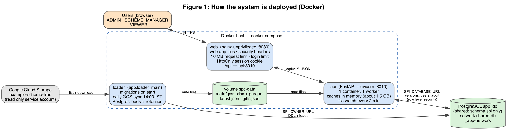
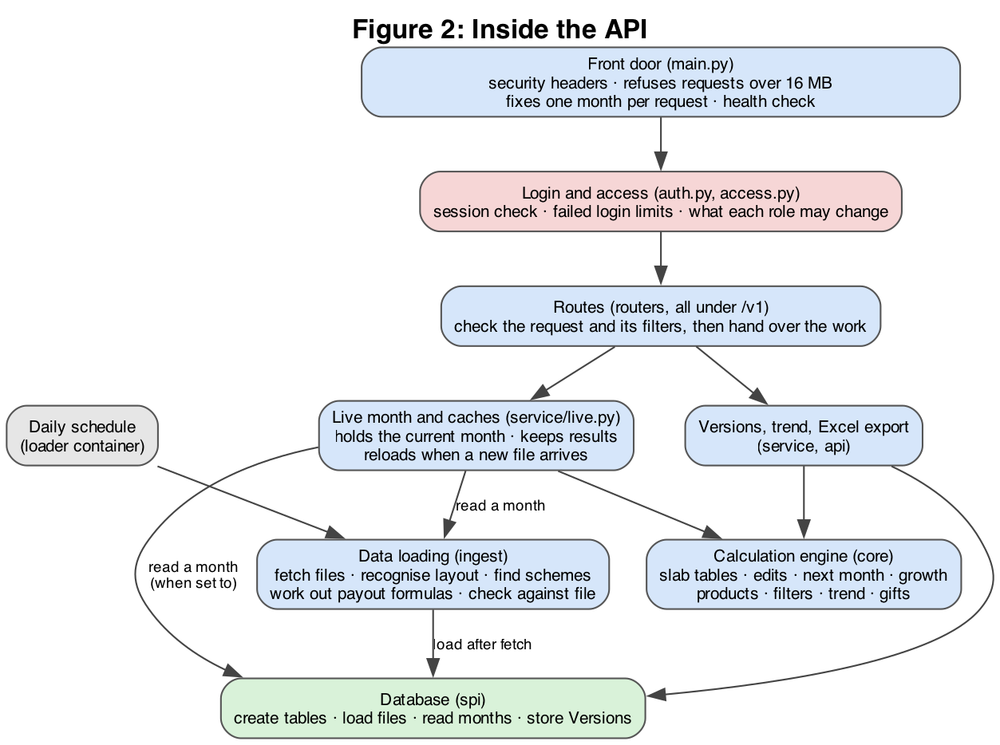
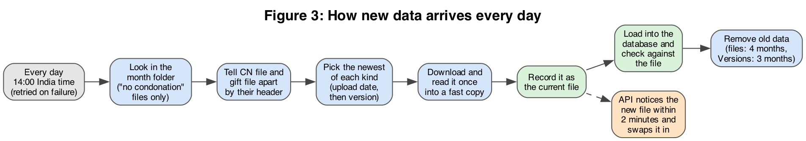
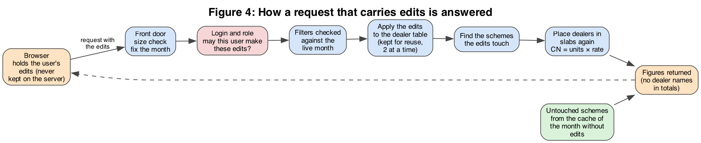
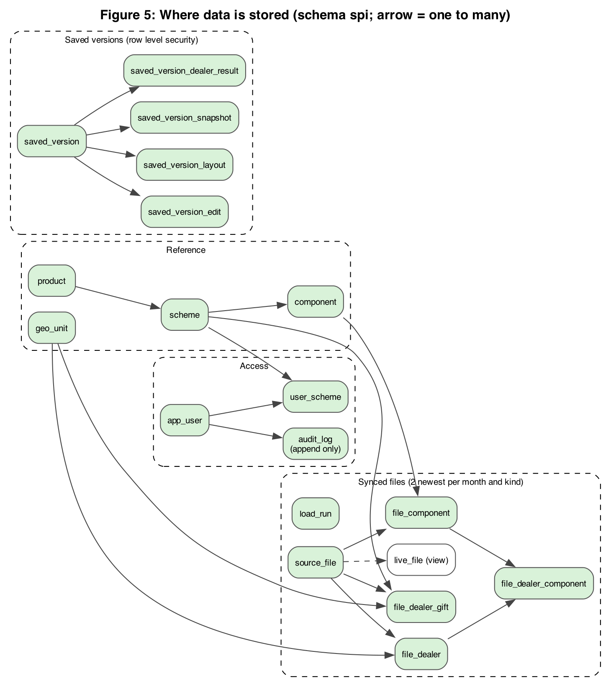

# Scheme Performance & Impact Calculator and Planner

### Technical Solution Document

Version 1.1 · For review · 16-11-2026

## Document control

| Item | Value |
| --- | --- |
| Document | Scheme Performance & Impact Calculator and Planner: Technical Solution Document |
| Version | 1.1 |
| Date | 16-11-2026 |
| Prepared by | Engineering team |
| Status | For review |
| Client | Acme Paints |
| Audience | Developers, reviewers and the DevOps team |
| Branch described | dev |
| Related documents (in the repo) | docs/logic.md (formulas with examples), docs/erd.md (tables), backend/db/scheme_performance_calculator/README.md (database setup) |

## Index

| Section | Page |
| --- | ---: |
| [1. Purpose and scope](#1-purpose-and-scope) | 3 |
| [2. The problem and what the design must achieve](#2-the-problem-and-what-the-design-must-achieve) | 3 |
| [3. The solution at a glance](#3-the-solution-at-a-glance) | 4 |
| [4. Architecture](#4-architecture) | 5 |
| [5. How new data arrives every day](#5-how-new-data-arrives-every-day) | 9 |
| [6. How CN is calculated](#6-how-cn-is-calculated) | 10 |
| [7. How a request is answered quickly](#7-how-a-request-is-answered-quickly) | 12 |
| [8. Where data is stored](#8-where-data-is-stored) | 14 |
| [9. The API](#9-the-api) | 15 |
| [10. Security and access](#10-security-and-access) | 17 |
| [11. Speed and capacity](#11-speed-and-capacity) | 18 |
| [12. Running and operating it](#12-running-and-operating-it) | 19 |
| [13. Testing](#13-testing) | 20 |
| [14. Key design decisions](#14-key-design-decisions) | 21 |
| [15. Known limits and open items](#15-known-limits-and-open-items) | 22 |
| [16. How to extend it safely](#16-how-to-extend-it-safely) | 23 |
| [17. Glossary](#17-glossary) | 24 |
| [Assumptions](#assumptions) | 24 |

**List of figures**

| Figure | Page |
| --- | ---: |
| [Figure 1: How the system is deployed](#41-how-it-is-deployed) | 5 |
| [Figure 2: Inside the API](#42-inside-the-api) | 7 |
| [Figure 3: How new data arrives every day](#5-how-new-data-arrives-every-day) | 9 |
| [Figure 4: How a request that carries edits is answered](#7-how-a-request-is-answered-quickly) | 12 |
| [Figure 5: Where data is stored](#8-where-data-is-stored) | 14 |

---

## 1. Purpose and scope

This document explains how the Scheme Performance & Impact Calculator is built and why it is built that way. It
is the starting point for anyone who will change the code, review it or run it on a server.

It covers the web app, the API, the database, the daily data load, deployment with Docker and the tests. Screens
and formulas are explained in more detail in the related documents listed above.

---

## 2. The problem and what the design must achieve

Acme Paints pays its dealers **credit notes (CN)** under rebate schemes. A dealer earns a CN when their sales reach
a slab of a scheme. The business wants to see last month, this month and next month side by side, change a scheme
or a sales figure, and see straight away what that does to CN, for all India or for any zone, region or depot.

| What the business needs | How the design delivers it |
| --- | --- |
| No one has to upload files | The newest extract is fetched from Google Cloud Storage every day and swapped in without a restart. |
| Figures match what was actually paid | Every payout is worked out as units × rate, where the units come from what was paid. A row nobody has changed therefore gives exactly the paid amount. Each scheme is also checked against the file's own payout column. |
| Answers within a second, on about 600,000 rows | All calculations run in memory, results are kept in caches, and an edit recalculates only the schemes it actually touches. |
| Two users never see each other's unsaved work | Edits stay in the user's browser and are sent with each request. The server keeps only results that are the same for everyone. Only a Version the user chooses to save is stored. |
| Safe on a database shared with other apps | The app keeps everything in its own schema (spi), uses one login to read and write and a separate one to change tables, and the database itself limits who sees which saved Version. |
| Errors that anyone can understand | Every error is one plain sentence. The screen never shows codes, JSON or technical messages. |

---

## 3. The solution at a glance

Data flows in one direction:

**Excel extract in Google Cloud Storage → daily load → one tidy table of dealers → calculation engine → API → web app**

The database keeps the loaded files, saved Versions, users and an audit log.

| What it does | Where the code is |
| --- | --- |
| Fetches the newest CN file and gift file every day | backend/app/ingest/gcs_sync.py, scheduler.py, loader_main.py |
| Finds the schemes in the file and works out how each one pays | backend/app/ingest (discover, calibrate, load_month) |
| Builds slab tables and places dealers in slabs again after an edit | backend/app/core/slab_engine.py |
| Applies sales edits, plans next month, prices growth | backend/app/core/scenario.py, plan.py, growth.py |
| Holds the live month and every cache | backend/app/service/live.py, backend/app/core/cache.py |
| Saves and reopens Versions | backend/app/spi/saved_versions.py and the matching service and router |
| Login and roles | backend/app/auth.py, access.py, users.py; frontend/src/auth.tsx |
| Excel export | backend/app/api/export.py |
| Screens: Overview, Plan, Simulator, Versions | frontend/src/App.tsx, frontend/src/app, frontend/src/components |

---

## 4. Architecture

### 4.1 How it is deployed

The app runs as three Docker containers on one server, started with Docker Compose.

| Part | What it is | What it does |
| --- | --- | --- |
| **Web** | nginx serving the built web app on port 8080 | Shows the screens and passes every /api call to the API. It adds the browser security headers, compresses answers, refuses requests over 16 MB and limits login attempts to 10 a minute per address. It is the only part users can reach. |
| **API** | Python with FastAPI and pandas | Does every calculation and returns the figures. It must run as **one container with one worker**, because its caches live in its own memory (about 1.5 GB when warm; the limit is 3 GB because a reload briefly holds two months). Every 2 minutes it checks whether a new file has arrived and swaps it in. It has only the database login that reads and writes data. |
| **Loader** | The same program, started in loader mode | Creates or updates the database tables at start, fetches the new file every day at 14:00 India time (and retries on failure), loads it into the database and deletes data past its retention period. It is the only part with the login that may change tables. Exactly one loader must run. |
| **Shared folder** (Docker volume spc-data) | Files on disk | Holds the downloaded Excel files, fast parsed copies of them and small pointer files naming the current file. The loader writes, the API reads. |
| **Database** | The existing shared PostgreSQL database (app_db) | Holds the loaded files, saved Versions, users and the audit log, all inside the schema spi. |
| **Google Cloud Storage** | Bucket example-scheme-files | Where Acme Paints publishes the monthly extracts. The app reads it with a read only service account. |

Without Docker (one process on a developer machine) the API can run the daily fetch itself. This is off by default
on a developer machine.

### 4.2 Inside the API

The API is built in layers. Each layer only calls the one below it.

| Layer | Folder | What it is responsible for |
| --- | --- | --- |
| Front door | main.py | Starts the app and warms the caches, adds security headers, refuses oversized requests, makes each request use one month throughout, and answers the health check. The API's own documentation pages are shown only on a developer machine. |
| Login and access | auth.py, access.py, users.py | Checks the session, limits failed logins and decides what each role may change. |
| Routes | routers | Receive a request, check its body and its filters, check access, and hand the work to a service. All business routes start with /v1. |
| Services | service | Hold the live month and all caches (live.py), saved Versions and the month trend. |
| Calculation engine | core | Pure calculations on tables of numbers. No files, no database, no web requests. |
| Data loading | ingest | Fetches files, recognises the file layout, finds schemes, works out payout formulas, checks results against the file, reads gift files. |
| Database | spi | Creates tables, loads files, reads a month back from the database, stores Versions. |

### 4.3 Inside the web app

The web app is written in React with TypeScript and built with Vite. It uses no extra state library. Fonts are
bundled with the app because the security policy allows fonts from the app's own address only.

| Part | Where | What it does |
| --- | --- | --- |
| Main screen and shared state | App.tsx | Holds the user's edits and connects all parts. State that every tab needs lives here; logic goes into a separate hook or function. |
| Loading data | app/useScopeData.ts | Loads the slab tables for the chosen filters, keeps answers in the right order and retries every 5 seconds while the API is starting. |
| Edits | useCellEdits.ts, useSlabEdits.ts, app/edits.ts | Turn figures typed in the month table, slab boundaries and rates into edit records, including next month's own slab tables. |
| Navigation and export | useDetailNav.ts, useExport.ts, hooks/useUrlState.ts | Keep the tab and filters in the address bar, so Back and reload work. |
| Screens | components (MonthsView, SchemeCard, DealerList, VersionsView, GiftsView, CommandBar) | The Simulator is one table with Previous, Current and Next columns. Current and Next can be edited. |
| Talking to the API | api/client.ts | Calls /api/v1, cancels a request when a newer one replaces it, and turns every failure into a plain sentence. |

---

## 5. How new data arrives every day

1. **Look in the month folder** in Google Cloud Storage. Only files directly in that folder are used. The daily
   subfolder is never read, because not every extract is copied there.
2. **Keep only the "no condonation" files** (the name ends in _v<N>_no_condonation.xlsx).
3. **Tell the two kinds of file apart.** The CN extract and the gift file share the folder and the name pattern,
   and their version numbers are mixed. The app reads only the header of each file: a file with the business GSR
   columns is the CN extract; anything else is a gift file. The answer is remembered for each file.
4. **Pick the newest** of each kind: latest upload date in India time, then the highest version number. A file
   produced after its month ended is treated as the complete month.
5. **Download it and read it once** into a fast copy on disk, then record it as the current file.
6. **Load it into the database** in one transaction and compare the stored rows with the file. Any difference
   cancels the whole load. Each month keeps its two newest files of each kind; older ones are removed in the same
   step and the table space is cleaned up afterwards.
7. **Remove old data:** files and database data older than the current month plus the three before it; saved
   Versions older than the live month plus the two before it.
8. **Swap it in:** the API notices the new file within 2 minutes, builds the new month, empties every cache and
   warms them again. If the database load failed, the run is tried again later.

---

## 6. How CN is calculated

### 6.1 Scheme rules are read from the data

The extract does not contain the slab tables, and its column names cannot be trusted. For example, a column named
"VALUE FA CN%" holds a fixed rupee amount, not a percentage. The files have also come in three different layouts.
So the app works the rules out from the data itself:

- **Layout:** recognised from the two header rows, not from the file name.
- **Schemes:** found by matching patterns in the header.
- **Payout formula:** each possible formula is tested against the file's own payout column ("Clear Cut"), and the
  one that reproduces it is kept.
- **Slab boundaries:** each dealer row shows the dealer's achievement and how far they are from the next slab.
  Adding the two lands exactly on the next boundary, so the distinct sums are the slab boundaries. Boundaries are
  always taken from the whole country, never from the filtered view, because a slab table belongs to the scheme,
  not to a region.

The result is one tidy table with a row for each dealer and each part of each scheme.

### 6.2 Rules that must never break

Breaking one of these does not cause an error. It produces figures that look right and are wrong.

| Rule | What it means |
| --- | --- |
| CN = units × rate | The units come from what was actually paid (paid amount ÷ the rate that earned it). An actual CN is never simply scaled up or down. |
| The slab and the payout can use different measures | Luxury decides the slab on litres but pays a percentage of rupees. The two are never mixed. |
| GSR = list price × (1 − in bill discount) | The in bill discount is not a CN scheme, but changing it changes GSR, and through GSR the CN of every percentage scheme. |
| A dealer's business GSR is counted once | It is the sum of three named columns, counted once for each dealer. The early bird full month GSR is never used, because it is empty for every South dealer. Scheme GSRs are never added together, as the same sale appears under several schemes. |
| Within a scheme, each source column counts once | Parts that pay on litres already counted in the main column (per 50 L, per 100 L and similar add ons) are not counted again. |
| A part month is not a small month | Trends and forecasts use complete months only. |
| Paid CN cannot be recovered; sales are held fixed | A lower simulated CN is the cost of a future structure, not a saving. The screen says so. |
| Gifts are not CN | Gift schemes are shown on their own and never enter any CN total. |

### 6.3 What happens when a slab is changed

When a user moves a slab boundary, adds or removes a slab, or changes a rate, every dealer is placed in the slabs
again:

- A dealer who is still in the same slab keeps exactly the rate they had.
- A dealer who moves into another slab gets the rate most dealers of their region earn in that slab (the national
  rate where the region has none).
- Leaving the boundaries as they are changes nothing (checked on all 232 scheme parts in three filter views).

**Two methods are kept on purpose.** In the Simulator and next month, a dealer who crosses into another slab is
counted there but keeps the rate they actually earned. The Plan tab's growth calculator gives them the new slab's
rate instead. The two answers therefore differ for the same growth. This was agreed with the client and must not
be changed without the user.

### 6.4 What happens when sales are changed

A user can type a new figure into the month table. Which figure they type decides what moves:

| Typed into | Code | What moves |
| --- | --- | --- |
| Total volume or GSR | B | Every product, in proportion |
| One product's volume or GSR | P | That product only; the total moves with it |
| One product's share of volume | A | That product's share; total GSR stays the same and the other products give way in proportion |
| One product's GSR as a price | Q | GSR and rupee based slabs move; litres stay the same |
| One product's CN % or CN, or the total CN | R | The rates of that product (or of every product) scale to the typed figure |
| One scheme's (or one slab's) volume or GSR | S | Only that scheme's dealers |
| One scheme's CN | C | That scheme's rates |

An edit applies to the filters it was typed under, and every view applies every edit: an edit made for one region
also shows in the all India view. Broader edits are applied first. Next month is this month with its edits, grown
by the planned volume change, and then next month's own edits.

---

## 7. How a request is answered quickly

### 7.1 One month per request

Everything about the live month (the file, the dealer table and the slab boundaries) is held together and replaced
as a whole when a new file arrives. Each request is fixed to the month it started with, so a new file arriving
during a request can never mix two months in one answer.

### 7.2 Caches

| How it works | Why |
| --- | --- |
| Every cached result is tied to the live month | A new month never shows old results. |
| A result being built is built once | If several users ask for the same thing at the same moment, they all wait for one calculation instead of each starting their own. |
| The all India slab tables are never removed from the cache | They are the most used view and the slowest to build. |
| At most 2 heavy edit calculations run at once | Each one needs about 0.11 GB. A request that waits more than 90 seconds gets "The server is busy" with a time to retry. |
| Only the schemes an edit touches are recalculated | The rest come from the cache of the month without edits, which makes edits 3 to 5 times faster. |
| Filter values are checked against the live month | Made up values cannot fill the cache and push out useful results. |

Two rules for developers: never cache anything that belongs to one user's edits (edited tables are cached only as
pure results of the edits sent), and add every new cache to the list that is emptied when a new month arrives.

---

## 8. Where data is stored

Everything is in the schema **spi** of the existing shared database. Nothing outside that schema is created or
changed.

| Group | Tables | Notes |
| --- | --- | --- |
| Reference | product, scheme, component, geo_unit | Schemes and their parts as read from each file; zones, regions and depots. |
| Loaded files | source_file, file_component, file_dealer, file_dealer_component, file_dealer_gift, load_run, and the view live_file | The two newest files of each kind for each month. About 125 MB per CN file, about 1 GB for four months. |
| Saved Versions | saved_version, saved_version_edit, saved_version_layout, saved_version_snapshot, saved_version_dealer_result | The user's edits, their slab tables for this month and next, and the results. The database itself decides which rows each user may see. A save is written in one transaction. |
| Access | app_user, user_scheme, audit_log | Users, the schemes each scheme manager may edit, and an audit log that the app can add to but never change. |

Rules:

- Table changes are numbered SQL files, each applied once and recorded with a checksum.
- The API reads month data from files by default, or from the database when told to. A month missing from the
  database is read from files.
- Version names are unique (case and spaces at either end ignored). Each login may keep at most 10 Versions that
  are not archived. Both rules are checked again inside the save itself, so two saves at the same moment cannot
  break them.
- Open Versions are recalculated each time a new file of the live month arrives.
- The other schemas in the shared database (public, drizzle) are never touched.

---

## 9. The API

All business routes start with **/v1**; the web app calls them through nginx as /api/v1. The health check (/health)
stays outside /v1 and needs no login. A change that would break a client (a field renamed or removed, or a meaning
changed) goes into a new /v2 while /v1 keeps working. Adding a field is not such a change.

| Area | Routes |
| --- | --- |
| Login | POST /auth/login, POST /auth/logout, GET /auth/me |
| Reference | GET /schemes, GET /filters, GET /reconciliation |
| Slab tables | GET /all-slabs, GET /slabs, POST /all-slabs/adjusted, POST /simulate-slabs, POST /simulate |
| Month table | GET /months, POST /months, POST /months/next, POST /months/scheme, POST /months/edited |
| Dealer lists | POST /dealers (a page at a time, for the previous, current or next month) |
| Planning and trend | POST /growth, GET /trend |
| Gifts | GET /gifts, POST /gifts/detail |
| Versions | GET, POST, PUT, PATCH and DELETE under /saved-versions (list, preview, save, change, open, results, dealers, archive or restore, delete). The older status route still works until 31 January 2027. |
| Export | POST /export (Excel file with Summary, Schemes and Slabs sheets) |

How the API behaves:

- **Questions that carry edits are sent as POST**, because the edits travel in the request and can be several MB.
- Requests that change something must be JSON. Requests over 16 MB are refused, by nginx and by the API.
- A refused request gets one sentence: "This request was refused: <field>: <reason>." The value that was sent is
  never repeated back. Filters take at most 500 values; at most 40 product share edits per request.
- Errors never contain technical messages or file paths. The details go to the server log only.
- Totals never contain dealer codes or names. Only dealer lists and saved Version results do, and a test checks
  this.
- Answers are marked so that browsers do not store them.

---

## 10. Security and access

| Topic | How it is handled |
| --- | --- |
| Login | Users come from the settings file (a built in admin and more users stored as password hashes) and from the database (any role). After login the browser holds a signed session cookie for 8 hours that page scripts cannot read and other sites cannot send. Logging out ends the session on the server. Changing a user's password or role ends their sessions. |
| Too many failed logins | 5 failures per address, or 10 per user name and address, within 15 minutes block further attempts. nginx also allows only 10 login attempts a minute per address. The real client address is trusted only when it comes from a known proxy. |
| Safe by default | On a server without users and a session secret, every business route answers "Login is not set up". If the environment name is missing, the app behaves as a locked down server. |
| Roles | **Admin:** everything. **Scheme manager:** sees everything and the dealer lists, but edits only the schemes assigned to them (slab tables, a scheme's volume, GSR and CN, gift rules) and saves and manages only their own Versions. **Viewer:** sees every view; no edits, no dealer lists, no saving. |
| Checked three times | The screen shows edit boxes only where they are allowed; the API checks every request that carries edits and refuses with a plain sentence; the database itself limits which saved Versions each user can read or change. Anyone may open someone else's Version, but not change it. |
| Least privilege | The API has only a login that reads and writes data. Only the loader may change tables. Cloud Storage access is read only. |
| Audit | Logins, failed logins, user and access changes, dealer lists, and every Version save, archive and delete are recorded in the server log and in the database. Dealer data is never logged. |
| Network | nginx sends the browser security headers. The site must be served over HTTPS; the secure cookie flag is switched off only while a test server runs on plain HTTP. |
| Dependencies | Python package versions are pinned, and both Python and JavaScript packages are checked for known vulnerabilities before every push. |

---

## 11. Speed and capacity

| Item | Figure |
| --- | --- |
| Data size | Tens of thousands of dealers and about half a million dealer × component rows a month |
| Start up | About 60 seconds (dealer table about 14 s, all India slab tables about 47 s). The month trend takes several minutes more. Until then the screen shows a placeholder instead of figures and retries every 5 seconds. The health check says "ready" once the main views are built. |
| Answers once warm | All India slab tables about 0.3 s; month trend about 0.4 s |
| An edit | About 0.2 to 0.7 s per request once warm |
| Memory | API about 1.5 GB when warm, limit 3 GB. Loader limit 2 GB (its peak while reading a new month is not measured yet). |
| Under load | At most 2 heavy edit calculations at once; others wait up to 90 seconds |
| Growing | One process on one server. Running several copies would need shared caches and is not needed for the current number of users. |

Restarting the API means paying the full start up time again, so it should not be restarted without need.

---

## 12. Running and operating it

### 12.1 Commands

| Task | Command (run from the repo root unless stated) |
| --- | --- |
| Start everything with Docker | docker compose --env-file backend/.env.dev up -d --build |
| Start the API on a developer machine | APP_ENV=local backend/.venv/bin/python -m uvicorn app.main:app --app-dir backend --port 8010 |
| Start the web app on a developer machine | npm --prefix frontend run dev (opens on port 5173 and passes /api to port 8010) |
| Fetch the newest file by hand | APP_ENV=local python -m app.ingest.gcs_sync (from backend) |
| Create or update the tables, load files | python -m app.spi.migrate, then python -m app.spi.load (from backend) |
| Add a user | python -m app.auth_user add NAME --role ADMIN, SCHEME_MANAGER or VIEWER (in Docker: through the loader container) |

### 12.2 Settings

Settings are read from backend/.env.<environment>; backend/.env.example lists every key. A key left empty must have
a working default in the code. A copy without comments (.env.dev.devops) is kept for the DevOps team; the code
never reads it and it is never committed.

| Setting | Meaning |
| --- | --- |
| APP_ENV | local, dev, uat or prod. Missing means a locked down server. |
| GCS_CREDENTIALS_JSON | The Cloud Storage service account key |
| SPI_DATABASE_URL, SPI_OWNER_URL | The login that reads and writes data, and the login that may change tables |
| DATA_SOURCE | files (default) or spi (read months from the database) |
| LOADER_DAILY_AT, LOADER_RETENTION_MONTHS, VERSION_RETENTION_MONTHS | Daily fetch time (14:00 India time) and how long files and Versions are kept (4 and 3 months) |
| ADMIN_USERNAME, ADMIN_PASSWORD, ADMIN_USERS, ADMIN_SESSION_SECRET, SESSION_COOKIE_SECURE | Login |
| SCHEME_MODE | all, or verified (only schemes that match the file's payouts) |
| VITE_API_BASE_URL | /api/v1, never left empty in the DevOps file |
| LIVE_MONTH, WATCH_SECONDS, TRUSTED_PROXIES, CORS_ORIGINS | Fix a month, how often to look for a new file, which proxies to trust, and requests from other addresses (empty) |

### 12.3 Daily checks

- The health check (/api/health) shows "ready" about a minute after a start.
- The loader's log shows the daily fetch and database load; a failed load is retried.
- At the very first deployment, the loader's log shows that the first table set was created.
- If the loader stops while reading a new month, check whether Docker stopped it for lack of memory.

---

## 13. Testing

| Tests | Where | How to run |
| --- | --- | --- |
| Backend unit and data tests | backend/tests | python -m pytest (skip the checks on the live file with the "not data" option) |
| Web app unit tests | frontend/tests | npm --prefix frontend test |
| API tests | qa/api-tests | npm test in that folder |
| Screen tests in Chrome | qa | npm run test:ui (the web app must be running) |
| Load tests | qa/k6 | Only on the full final regression |
| Code checks and types | oxlint, ruff, TypeScript | Part of the full check below |
| Everything before a push | scripts/check.sh | Runs the tests, code checks, type check and build, and the vulnerability checks |

The tests guarantee, among other things, that an unchanged slab table moves by at most 0.01% per scheme part, that
every dealer list matches its count, that totals carry no dealer data, that the database's own access rules work,
that each role can do only what it should, and that the Simulator treats slab crossers as agreed. The list of test
cases is in qa/TEST_CASES.md and the latest results in qa/TEST_RESULTS.md. There is no automatic build on GitHub;
scripts/check.sh is run before every push.

---

## 14. Key design decisions

| Decision | Why | What it costs |
| --- | --- | --- |
| Read the scheme rules from the data | The extract has no slab tables and its column names are unreliable | The requirements ask for rules entered as configuration; that waits until the storage and database layouts are mapped |
| Calculate in memory in one API process | Answers within a second on about 600,000 rows | About a minute to start; grows only with a bigger server |
| Keep edits in the browser and send them with each request | Users never see each other's work; the API keeps no user state | Larger requests, hence POST and the 16 MB limit |
| Recalculate only the schemes an edit touches | Edits 3 to 5 times faster | Correctness depends on finding exactly those schemes; covered by data tests |
| A separate loader container | The login that may change tables stays out of the API; only one daily fetch runs | The two hand over new files through the shared folder |
| Own schema in the shared database | The DevOps team cannot create a new database | Other schemas must never be touched |
| Tell the file kinds apart by their header | CN and gift files share names and version numbers | One small header read per new file (remembered) |
| Version the API (/v1) | Clients keep working when the API changes | Two route sets during a breaking change |
| Keep two methods for slab crossers | Agreed with the client | The growth calculator and next month differ for the same growth |

---

## 15. Known limits and open items

| Item | Status |
| --- | --- |
| Scheme rules entered as configuration (requirements v1.0.1) | Not built; rules are still read from the data |
| Scheme types | About 3 of 7 are covered. Threshold value CN, first occurrence CN, overlapping qualifying periods and contest rules need dated transaction data the monthly file does not carry. |
| New products (putty, aluminium paint, Duro, Fixa, wallpaper) | No column in the extract, so they cannot be simulated |
| Which scheme belongs to which product | Worked out from scheme names; to be confirmed with the client |
| Shine On gift values 1 and 2 | Look like tiers, not counts; to be confirmed |
| Sessions and login limits | Kept in memory: a restart logs everyone out and resets the counters |
| Months before the daily fetch started | Read from files on the machine; a missing month is listed as not available |
| Fast file copies | Changing the parser version or finding a new scheme forces a full reread of the file, which takes several minutes |
| Old schema spc on the test server | Still needs to be dropped once (the user confirms first) |
| Test server deployment | The spi tables are created at the first start; the first daily fetch loads them |

---

## 16. How to extend it safely

| When you | Do | Avoid |
| --- | --- | --- |
| Add a route | Put it under routers, describe its request body in schemas.py, check filters through the live month, check access when it carries edits, and write errors as sentences | Putting technical error text in an answer; importing the live month directly instead of reading it through live.LIVE |
| Add a cache | Tie it to the live month and add it to the list emptied on reload | Caching anything that belongs to one user's edits |
| Change the API in a way clients notice | Add a /v2 route and keep /v1 | Renaming or removing a /v1 field |
| Change the database | Add a new numbered SQL file and keep the access rules | Editing a file that has already been applied |
| Add a setting | Add it to every env file and to .env.example, give it a default in the code, and regenerate the DevOps copy | Leaving a needed key empty in the DevOps file |
| Change the screens | Keep shared state in App.tsx and put logic in a hook or function with a test; show errors through the shared error text | Browser pop ups and raw error text |
| Change the calculation | Add or adjust a data test and prove that an unchanged slab table still moves ₹0 | Changing how slab crossers are paid without the user |

---

## 17. Glossary

| Term | Meaning |
| --- | --- |
| CN | Credit note: the rebate a dealer earns |
| GSR | Gross sales realisation: sales value after the in bill discount |
| List price (DPL) | The dealer price list |
| Clear Cut | The file's column with what each dealer was actually paid |
| Slab | A range of achievement that pays one rate |
| Scheme part (component) | One payout line of a scheme, for example its main slab or a per 50 L add on |
| Crosser | A dealer whose edited sales move them into another slab |
| Live month | The newest month with a loaded CN file |
| Version | A saved set of edits with its results (earlier called a scenario) |
| Filters (scope) | The zone, region and depot a view or an edit applies to |

---

## Assumptions

| # | Assumption | Based on |
| --- | --- | --- |
| A1 | Speed and memory figures are the last measurements recorded (developer laptop, November 2026 data), not measurements on the production server | Project notes and Docker Compose settings |
| A2 | The deployment shown is the Docker Compose setup used for the test server; UAT and production will follow it, but their servers are not yet confirmed | Docker Compose file; UAT and production settings are still empty |
| A3 | Figure 5 shows only the links defined in the database's table definitions; load_run and live_file have none | Table definitions in the migration files |
